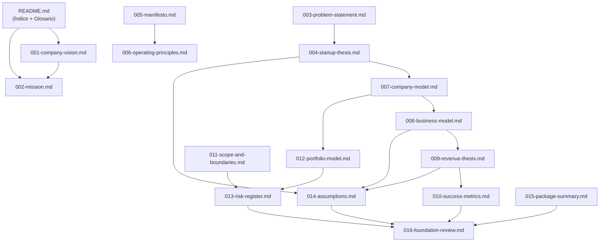
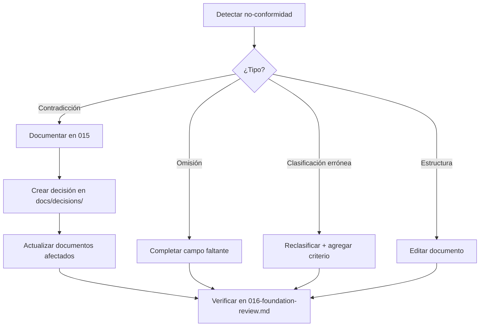

# Design Document — Package 000 Foundation

## Overview

Este documento de diseño define la **arquitectura documental** del Package 000 — Foundation de LabOS. No describe software, APIs, bases de datos ni infraestructura técnica. Describe cómo 16 documentos markdown se estructuran, relacionan entre sí, satisfacen los requisitos del package, y se validan para aprobación.

### Propósito del Diseño

El Package 000 es un **paquete exclusivamente documental** que establece la constitución fundacional de LabOS. El diseño debe resolver:

1. **Estructura**: Qué contiene cada documento y en qué orden se producen.
2. **Relaciones**: Cómo se referencian y dependen los documentos entre sí.
3. **Fuente de verdad**: Qué documento es autoritativo para cada concepto.
4. **Consistencia**: Cómo se garantiza coherencia terminológica y conceptual.
5. **Trazabilidad**: Cómo se vincula cada requisito con su evidencia de cumplimiento.
6. **Aprobación**: Cómo se determina que el package está completo.

### Decisiones de Diseño Clave

| Decisión | Rationale |
|----------|-----------|
| Un documento = un propósito | Alineado con documentation-standards: no mezclar temas |
| README.md como índice y glosario | Punto de entrada único; source of truth para terminología |
| Numeración secuencial 001-016 | Facilita orden de lectura y de producción |
| Cross-links explícitos entre documentos | Evita duplicación; mantiene single source of truth |
| 016-foundation-review.md como cierre | Contiene checklist, trazabilidad y resultado de aprobación |

---

## Architecture

### Arquitectura Documental del Package

El package se organiza como un **grafo dirigido acíclico (DAG)** de documentos donde cada nodo tiene un propósito único y las aristas representan dependencias de contenido.



### Capas Documentales

Los 16 documentos se organizan en 4 capas lógicas:

| Capa | Documentos | Propósito |
|------|-----------|-----------|
| **1. Identidad** | 001-vision, 002-mission, 003-problem-statement, 004-startup-thesis | Define qué es LabOS, por qué existe y cuál es su estado actual |
| **2. Principios** | 005-manifesto, 006-operating-principles | Establece reglas de comportamiento y decisión |
| **3. Modelo** | 007-company-model, 008-business-model, 009-revenue-thesis, 010-success-metrics, 011-scope-and-boundaries, 012-portfolio-model | Define cómo opera, monetiza y se organiza |
| **4. Gobernanza** | 013-risk-register, 014-assumptions, 015-package-summary, 016-foundation-review | Gestiona riesgos, valida supuestos y cierra el package |

El **README.md** actúa como capa transversal: índice, glosario y punto de entrada.

### Orden de Producción Recomendado

Los documentos deben producirse respetando las dependencias del DAG:

1. README.md (estructura base, glosario inicial)
2. 001-company-vision.md → 002-mission.md (identidad primero)
3. 003-problem-statement.md → 004-startup-thesis.md (contexto y estado)
4. 005-manifesto.md → 006-operating-principles.md (principios)
5. 007-company-model.md → 008-business-model.md → 009-revenue-thesis.md (modelo)
6. 010-success-metrics.md, 011-scope-and-boundaries.md, 012-portfolio-model.md (estructura operativa)
7. 013-risk-register.md, 014-assumptions.md (gobernanza)
8. 015-package-summary.md → 016-foundation-review.md (cierre)

---

## Components and Interfaces

### Descripción de Cada Documento (Componente)

Cada documento es un "componente" del package con propósito, estructura interna y interfaces (cross-links) definidos.

#### README.md — Índice y Glosario del Package

- **Propósito**: Punto de entrada único. Lista los 16 documentos, define el glosario autoritativo y declara el estado del package.
- **Secciones obligatorias**: Propósito, Lista de documentos (número + archivo + descripción ≤120 chars), Glosario (≥5 términos), Estado actual (`pendiente` | `en progreso` | `completo`).
- **Source of truth para**: Terminología del package, estado global, inventario de entregables.
- **Cross-links salientes**: Todos los documentos del package.
- **Cross-links entrantes**: Ninguno (es raíz).
- **Satisface**: Requisito 17.1, 17.2, 17.5, 18.2.

#### 001-company-vision.md — Visión de la Empresa

- **Propósito**: Declarar el estado futuro aspiracional de LabOS a 3+ años.
- **Secciones obligatorias**: Declaración de visión [Visión], horizonte temporal, tabla epistémica.
- **Restricción**: Máximo 300 palabras. Sin superlativos. Sin promesas de mercado.
- **Source of truth para**: Aspiración a largo plazo de LabOS.
- **Cross-links salientes**: 002-mission.md (diferenciación visión/misión).
- **Cross-links entrantes**: README.md.
- **Satisface**: Requisito 3.1, 3.3, 3.5, 2.1.

#### 002-mission.md — Misión Operativa

- **Propósito**: Declarar la intención operativa actual verificable de LabOS.
- **Secciones obligatorias**: Declaración de misión [Hecho], indicadores de progreso a 90 días (1-3), tabla epistémica.
- **Restricción**: Máximo 200 palabras. Sin capacidades no implementadas. Sin resultados no obtenidos.
- **Source of truth para**: Intención operativa presente, indicadores de progreso inmediato.
- **Cross-links salientes**: 010-success-metrics.md (métricas alineadas).
- **Cross-links entrantes**: 001-company-vision.md, README.md.
- **Satisface**: Requisito 3.2, 3.4, 3.5, 2.1.

#### 003-problem-statement.md — Problema Central

- **Propósito**: Definir qué problema resuelve LabOS con especificidad de segmento, pérdida observable y alternativas insuficientes.
- **Secciones obligatorias**: Segmento de usuario (rol + contexto + tamaño de mercado), consecuencia observable, alternativas existentes (≥2 con nombre), clasificación epistémica, tabla epistémica.
- **Source of truth para**: Definición del problema, segmento objetivo, análisis competitivo inicial.
- **Cross-links salientes**: 004-startup-thesis.md, 009-revenue-thesis.md (segmento).
- **Cross-links entrantes**: README.md.
- **Satisface**: Requisito 4.1, 4.2, 4.3, 4.4, 2.1.

#### 004-startup-thesis.md — Tesis de Startup

- **Propósito**: Definir LabOS como startup en su estado actual real (pre-revenue, pre-product, documentation-first).
- **Secciones obligatorias**: Etapa actual, composición del equipo, fuentes de financiamiento, modelo de operación, clasificación epistémica, tabla epistémica.
- **Restricción**: Cada atributo de etapa (pre-revenue, pre-product, documentation-first) debe estar etiquetado como [Hecho].
- **Source of truth para**: Estado actual de LabOS como empresa, etapa de madurez.
- **Cross-links salientes**: 007-company-model.md (estructura detallada), 014-assumptions.md.
- **Cross-links entrantes**: 003-problem-statement.md, README.md.
- **Satisface**: Requisito 1.1, 1.2, 1.4, 1.5, 2.1.

#### 005-manifesto.md — Manifiesto

- **Propósito**: Declarar principios fundamentales con anti-patrones observables que permitan identificar violaciones.
- **Secciones obligatorias**: Declaraciones de principio (3-10), cada una con anti-patrón asociado, tabla epistémica.
- **Restricción**: Cada principio debe tener comportamiento observable/medible. Sin lenguaje aspiracional sin criterio de verificación.
- **Source of truth para**: Creencias fundamentales y anti-patrones del sistema.
- **Cross-links salientes**: 006-operating-principles.md (implementación de principios).
- **Cross-links entrantes**: README.md.
- **Satisface**: Requisito 5.1, 5.3, 5.4, 5.5, 2.1.

#### 006-operating-principles.md — Principios Operativos

- **Propósito**: Reglas operativas concretas y accionables para decisiones diarias.
- **Secciones obligatorias**: Reglas operativas (5-15), cada una con condición de aplicación + acción esperada + ejemplo concreto, principio de prioridad de ingresos, tabla epistémica.
- **Restricción**: No puede prescribir acciones mutuamente excluyentes con 005-manifesto.md para la misma condición.
- **Source of truth para**: Reglas de decisión operativa, priorización de actividades.
- **Cross-links salientes**: 008-business-model.md (priorización de flujo de caja).
- **Cross-links entrantes**: 005-manifesto.md, README.md.
- **Satisface**: Requisito 5.2, 5.3, 5.4, 14.3, 2.1.

#### 007-company-model.md — Modelo de Empresa

- **Propósito**: Definir estructura organizativa actual y el modelo asset-first.
- **Secciones obligatorias**: Estructura organizativa (1 fundador, 0 empleados, sin inversión, sin contratos), Asset_First_Model (definición, taxonomía de activos, criterio mínimo, estados y transiciones), tabla epistémica.
- **Source of truth para**: Estructura organizativa, definición del Asset_First_Model, taxonomía de activos, lifecycle de activos.
- **Cross-links salientes**: 008-business-model.md, 012-portfolio-model.md, 014-assumptions.md.
- **Cross-links entrantes**: 004-startup-thesis.md, README.md.
- **Satisface**: Requisito 1.3, 1.5, 8.1, 8.2, 8.3, 8.4, 8.5, 8.6, 2.1.

#### 008-business-model.md — Modelo de Negocio

- **Propósito**: Definir mecanismos de monetización por etapas con prioridad de flujo de caja inmediato.
- **Secciones obligatorias**: Etapas (inmediato 0-30d, corto 30-90d, mediano 90-365d), mecanismos por etapa con criterio de validación, rutas de flujo de caja inmediato (≥2), clasificación por tipo de flujo, tabla epistémica.
- **Restricción**: Cada mecanismo clasificado como [Hipótesis]. Etapa inmediata primero y con mayor peso.
- **Source of truth para**: Mecanismos de monetización, priorización de ingresos, rutas de caja inmediata.
- **Cross-links salientes**: 009-revenue-thesis.md, 014-assumptions.md.
- **Cross-links entrantes**: 007-company-model.md, 006-operating-principles.md, README.md.
- **Satisface**: Requisito 6.1, 6.2, 6.3, 6.4, 6.5, 14.1, 14.2, 14.4, 14.5, 2.1.

#### 009-revenue-thesis.md — Tesis de Ingresos

- **Propósito**: Documentar la Revenue_Thesis con fuentes de ingreso, precios, validación y experimentos mínimos.
- **Secciones obligatorias**: Fuentes de ingreso (con mecanismo, precio como rango, segmento, criterio de validación), experimento mínimo por fuente, referencias de mercado, tabla epistémica.
- **Restricción**: Toda la sección clasificada como [Hipótesis] hasta transacción real documentada. Precios con referencia verificable.
- **Source of truth para**: Revenue_Thesis, pricing, experimentos de validación de ingresos.
- **Cross-links salientes**: 010-success-metrics.md, 014-assumptions.md.
- **Cross-links entrantes**: 008-business-model.md, 003-problem-statement.md, README.md.
- **Satisface**: Requisito 7.1, 7.2, 7.3, 7.4, 7.5, 2.1, 2.2.

#### 010-success-metrics.md — Métricas de Éxito

- **Propósito**: Definir métricas específicas y medibles para evaluar el package y el progreso de LabOS.
- **Secciones obligatorias**: Métricas del package (≥2), métricas operativas a 30d (≥2), métricas de negocio a 90d (≥2), cada una con nombre + definición operativa + método + valor objetivo + frecuencia + línea base, al menos 1 métrica de salud del portfolio, tabla epistémica.
- **Restricción**: Toda métrica con valor objetivo cuantificado numéricamente o condición binaria. Sin "mejorar" ni "aumentar" genérico.
- **Source of truth para**: KPIs del package, métricas operativas, métricas de negocio.
- **Cross-links salientes**: 016-foundation-review.md (criterios de éxito).
- **Cross-links entrantes**: 009-revenue-thesis.md, 002-mission.md, README.md.
- **Satisface**: Requisito 10.1, 10.2, 10.3, 10.4, 10.5, 2.1.

#### 011-scope-and-boundaries.md — Alcance y Límites

- **Propósito**: Definir qué está dentro y fuera del package, límites regulatorios y propiedad intelectual.
- **Secciones obligatorias**: Alcance incluido (≥3 ítems), Exclusiones explícitas (≥5 ítems), Límites de propiedad intelectual (3 categorías: exclusiva, open source, licenciable), marcos regulatorios (datos personales, PI, IA generativa por jurisdicción), política de PI por origen (fundador, IA, terceros), límite temporal, tabla epistémica.
- **Source of truth para**: Alcance del package, exclusiones, PI, regulaciones aplicables.
- **Cross-links salientes**: 013-risk-register.md (riesgos regulatorios).
- **Cross-links entrantes**: README.md.
- **Satisface**: Requisito 11.1, 11.2, 11.3, 11.4, 11.5, 11.6, 15.1, 15.2, 15.4, 15.5, 2.1.

#### 012-portfolio-model.md — Modelo de Portfolio

- **Propósito**: Definir estructura del portafolio de labs, estados, transiciones y reglas de priorización.
- **Secciones obligatorias**: Lista de labs (nombre, dominio, hipótesis de producto, estado, criterio de avance), estados válidos y transiciones, reglas de priorización, justificación de capacidad si >5 labs activos, tabla epistémica.
- **Source of truth para**: Portfolio de labs, estados, reglas de priorización entre labs.
- **Cross-links salientes**: 013-risk-register.md (riesgos de portfolio).
- **Cross-links entrantes**: 007-company-model.md, README.md.
- **Satisface**: Requisito 9.1, 9.2, 9.3, 9.4, 9.5, 2.1.

#### 013-risk-register.md — Registro de Riesgos

- **Propósito**: Identificar y documentar amenazas críticas con mitigaciones concretas.
- **Secciones obligatorias**: Registro (≥8 riesgos), cada uno con descripción ≤200 chars + probabilidad + impacto + categoría + mitigación + owner. Riesgos obligatorios: bus factor=1, privacidad (≥2), PI (≥3), financiero (≥1), IA generativa. Frecuencia de revisión, fecha próxima revisión, tabla epistémica.
- **Source of truth para**: Riesgos identificados, mitigaciones, plan de revisión de riesgos.
- **Cross-links salientes**: 016-foundation-review.md.
- **Cross-links entrantes**: 011-scope-and-boundaries.md, 012-portfolio-model.md, README.md.
- **Satisface**: Requisito 12.1, 12.2, 12.3, 12.4, 12.5, 12.6, 12.7, 15.3, 15.5, 2.1.

#### 014-assumptions.md — Supuestos y Dependencias

- **Propósito**: Listar explícitamente qué supone el fundador como verdad sin validación, con plan de validación.
- **Secciones obligatorias**: Supuestos (cada uno con enunciado atómico + confianza + método validación + horizonte ≤90d + referencia a documento), categorías obligatorias (demanda, disposición a pagar, capacidad fundador, viabilidad asset-first), sección resumen de riesgos abiertos (confianza baja sin plan), tabla epistémica.
- **Source of truth para**: Supuestos fundacionales, niveles de confianza, planes de validación.
- **Cross-links salientes**: 016-foundation-review.md.
- **Cross-links entrantes**: 004-startup-thesis.md, 008-business-model.md, 009-revenue-thesis.md, README.md.
- **Satisface**: Requisito 13.1, 13.2, 13.3, 13.4, 13.5, 2.1.

#### 015-package-summary.md — Resumen del Package

- **Propósito**: Consolidar decisiones registradas en todos los documentos y declarar consistencia inter-documentos.
- **Secciones obligatorias**: Lista por documento de decisiones registradas, declaración de consistencia (sin contradicciones o lista de contradicciones pendientes), tabla epistémica.
- **Source of truth para**: Inventario de decisiones, estado de consistencia inter-documentos.
- **Cross-links salientes**: 016-foundation-review.md.
- **Cross-links entrantes**: Todos los documentos del package (lee decisiones de cada uno).
- **Satisface**: Requisito 17.3, 17.4, 2.1.

#### 016-foundation-review.md — Revisión y Aprobación

- **Propósito**: Definir y ejecutar los criterios de aprobación del package con resultado binario.
- **Secciones obligatorias**: Checklist de aprobación (pasa/no pasa con referencia a documento), matriz de trazabilidad (requisito → documento → sección), proceso de revisión (auto-revisión + fecha + justificación de no-pasa), resolución de contradicciones si existen, tabla epistémica.
- **Source of truth para**: Estado de aprobación del package, trazabilidad requisito-documento.
- **Cross-links salientes**: Ninguno (es nodo terminal).
- **Cross-links entrantes**: 015-package-summary.md, 013-risk-register.md, 014-assumptions.md, 010-success-metrics.md.
- **Satisface**: Requisito 16.1, 16.2, 16.3, 16.4, 16.5, 2.1.

---

## Data Models

### Modelo de Datos: Estructura Interna de Cada Documento

Dado que no hay base de datos ni software, el "modelo de datos" describe la estructura formal que cada documento debe seguir.

#### Estructura Base de Documento (aplica a los 16)

```yaml
documento:
  nombre_archivo: string  # kebab-case, inglés
  titulo_h1: string       # español
  secciones_h2: array     # ≥1 sección
  contenido_prosa: string # ≥100 palabras (excluyendo headers y metadatos)
  idioma_contenido: "español"
  idioma_archivo: "inglés"
  tabla_epistemica:       # obligatoria al final
    hechos: { cantidad: int, porcentaje: float }
    hipotesis: { cantidad: int, porcentaje: float }
    visiones: { cantidad: int, porcentaje: float }
```

#### Modelo de Afirmación Clasificada

```yaml
afirmacion:
  texto: string
  clasificacion: "[Hecho]" | "[Hipótesis]" | "[Visión]"
  # Si es hipótesis con proyección:
  criterio_validacion:
    metrica_observable: string
    umbral_exito_fracaso: string
    plazo_maximo_dias: int  # ≤90
  # Si es hecho:
  fuente_verificable: string | null  # referencia observable
```

#### Modelo de Métrica (010-success-metrics.md)

```yaml
metrica:
  nombre: string
  definicion_operativa: string
  metodo_medicion: string
  valor_objetivo: string  # numérico, porcentaje o binario
  frecuencia_revision: "semanal" | "quincenal" | "mensual"
  linea_base: string      # valor actual o "0"
  categoria: "package" | "operativa" | "negocio"
```

#### Modelo de Riesgo (013-risk-register.md)

```yaml
riesgo:
  descripcion: string     # ≤200 caracteres
  probabilidad: "alta" | "media" | "baja"
  impacto: "crítico" | "alto" | "medio" | "bajo"
  categoria: "operativo" | "financiero" | "legal" | "técnico" | "personal"
  mitigacion: string      # acción concreta ejecutable
  owner: string           # "fundador" por defecto
  es_prioritario: bool    # true si probabilidad=alta AND impacto∈{crítico,alto}
```

#### Modelo de Supuesto (014-assumptions.md)

```yaml
supuesto:
  enunciado: string       # atómico
  confianza: "alto" | "medio" | "bajo"
  metodo_validacion: string  # acción + métrica de éxito
  horizonte_dias: int     # ≤90
  documento_impactado: string  # e.g. "008-business-model.md"
  categoria: "demanda" | "disposicion_pagar" | "capacidad_fundador" | "viabilidad_asset_first" | "otro"
  etiqueta_riesgo: "🔴 Riesgo Abierto" | null  # si confianza=bajo sin plan
```

#### Modelo de Activo (007-company-model.md)

```yaml
activo:
  nombre: string          # ≤80 caracteres
  tipo: "documento" | "template" | "dataset" | "herramienta" | "componente" | "framework" | "playbook"
  descripcion: string     # 1-3 oraciones, qué problema resuelve
  hipotesis_uso:
    usuario_objetivo: string
    contexto_aplicacion: string
  estado: "borrador" | "validado" | "productizado"
  hipotesis_monetizacion:
    segmento_objetivo: string
    formato_entrega: string
    modelo_ingreso: string
  # Transiciones:
  # borrador → validado: revisión por owner + campos mínimos completos
  # validado → productizado: evidencia de uso real o prueba con usuario
```

#### Modelo de Lab (012-portfolio-model.md)

```yaml
lab:
  nombre: string
  dominio: string
  hipotesis_producto: string
  estado: "idea" | "explorando" | "validando" | "operando" | "pausado"
  criterio_avance: string  # evidencia observable requerida
  # Transiciones válidas: idea→explorando→validando→operando
  # Excepción: cualquier_estado→pausado
```

### Source of Truth por Concepto

| Concepto | Documento Autoritativo | Otros que lo referencian |
|----------|----------------------|--------------------------|
| Terminología / Glosario | README.md | Todos |
| Visión a largo plazo | 001-company-vision.md | 002-mission.md, 016-foundation-review.md |
| Misión operativa actual | 002-mission.md | 010-success-metrics.md |
| Problema central | 003-problem-statement.md | 004-startup-thesis.md, 009-revenue-thesis.md |
| Estado actual de LabOS | 004-startup-thesis.md | 007-company-model.md, 014-assumptions.md |
| Principios filosóficos | 005-manifesto.md | 006-operating-principles.md |
| Reglas operativas | 006-operating-principles.md | 008-business-model.md |
| Estructura organizativa | 007-company-model.md | 004-startup-thesis.md, 012-portfolio-model.md |
| Asset_First_Model | 007-company-model.md | 014-assumptions.md |
| Mecanismos de monetización | 008-business-model.md | 009-revenue-thesis.md, 006-operating-principles.md |
| Revenue_Thesis | 009-revenue-thesis.md | 010-success-metrics.md, 014-assumptions.md |
| KPIs y métricas | 010-success-metrics.md | 016-foundation-review.md, 002-mission.md |
| Alcance y exclusiones | 011-scope-and-boundaries.md | 013-risk-register.md |
| PI y regulación | 011-scope-and-boundaries.md | 013-risk-register.md |
| Portfolio de labs | 012-portfolio-model.md | 013-risk-register.md |
| Riesgos | 013-risk-register.md | 016-foundation-review.md |
| Supuestos | 014-assumptions.md | 016-foundation-review.md |
| Decisiones consolidadas | 015-package-summary.md | 016-foundation-review.md |
| Aprobación del package | 016-foundation-review.md | Ninguno |

### Convenciones Terminológicas

| Regla | Descripción |
|-------|-------------|
| Definición canónica en README.md | Cada término de dominio se define una sola vez en el glosario del README.md del package |
| Primera mención con referencia | Al usar un término por primera vez en un documento, incluir `(ver glosario)` o definición local |
| Sin sinónimos | No introducir sinónimos para conceptos ya definidos en el glosario |
| Grafía consistente | Mismo uso de mayúsculas, guiones y formato en todos los documentos |
| Términos técnicos en inglés | "Package", "blueprint", "spec", "asset", "lab" se usan sin traducir |
| Nuevos términos → glosario primero | Si un documento necesita un término nuevo, se agrega al glosario ANTES de usarlo |

### Mecanismo de Cross-Links

Los cross-links entre documentos siguen esta convención:

```markdown
<!-- Referencia a otro documento del package -->
(ver [007-company-model.md](./007-company-model.md#asset-first-model))

<!-- Referencia a steering document -->
(ver [business-principles](.kiro/steering/business-principles.md))

<!-- Referencia a decisión -->
(ver [decisión docs/decisions/NNNN-titulo.md])
```

Reglas de cross-link:
- Solo referenciar, nunca duplicar contenido de otro documento.
- Si un concepto se necesita en múltiples documentos, un documento es source of truth y los demás enlazan.
- Los cross-links deben ser relativos dentro del mismo directorio del package.

---

## Correctness Properties

*Sección intencionalmente omitida.*

Este package es exclusivamente documental — no produce código, funciones, transformaciones de datos ni lógica ejecutable. No existen inputs/outputs programáticos sobre los cuales formular propiedades universales ("for all X, P(X) holds"). Property-based testing no aplica a documentos markdown ni a checklist de conformidad.

La validación de correctness para este package se realiza a través del checklist de aprobación en `016-foundation-review.md` y la matriz de trazabilidad, definidos en la sección Testing Strategy.

---

## Error Handling

### Manejo de Inconsistencias y No-Conformidades

Dado que el package es documental, los "errores" son inconsistencias, omisiones o violaciones de estándares. El diseño define cómo detectarlos y resolverlos.

#### Tipos de No-Conformidad

| Tipo | Definición | Acción Correctiva |
|------|-----------|-------------------|
| **Hipótesis sin etiquetar** | Afirmación presentada como hecho sin fuente verificable | Reclasificar como [Hipótesis] + agregar criterio de validación |
| **Contradicción inter-documento** | Dos documentos afirman cosas incompatibles sobre el mismo concepto | Documentar en 015-package-summary.md + resolver con decisión en docs/decisions/ |
| **Término no definido** | Término de dominio usado sin estar en glosario | Agregar al glosario de README.md antes de considerar documento completo |
| **Principio contradictorio** | Dos principios prescriben acciones mutuamente excluyentes | Resolver en 005-manifesto.md o 006-operating-principles.md eliminando la contradicción |
| **Métrica no cuantificada** | Métrica con objetivo como "mejorar" sin umbral | Marcar como no conforme + excluir hasta reformulación |
| **Estructura incompleta** | Documento sin H1, sin H2, o con <100 palabras | Marcar archivo como incompleto en 016-foundation-review.md |
| **Activo sin hipótesis de monetización** | Activo en portfolio sin segmento + formato + modelo | Clasificar como incompleto para efectos de portfolio |
| **Supuesto de baja confianza sin plan** | Supuesto bajo sin horizonte temporal ni método | Marcar con 🔴 Riesgo Abierto + agregar a sección resumen |
| **Documento excede límite de palabras** | Visión >300 palabras o misión >200 palabras | Editar hasta cumplir límite |
| **Afirmación falsa de estado** | Declarar ingresos/empleados/inversión sin evidencia | Rechazar package en revisión (Req 1.4) |

#### Proceso de Resolución



#### Etiquetas de Estado de No-Conformidad

- `[INCOMPLETO]`: Campo requerido faltante (visible al inicio de la entrada).
- `🔴 Riesgo Abierto`: Supuesto bajo sin plan de validación.
- `[PENDIENTE DE ACTUALIZACIÓN]`: Sección regulatoria con >90 días sin revisión.

---

## Testing Strategy

### Estrategia de Validación del Package

Este package es exclusivamente documental. No aplica property-based testing, unit testing de código, ni tests automatizados de software. La "testing strategy" consiste en **validación manual estructurada** del cumplimiento de requisitos.

#### Por qué NO aplica Property-Based Testing

- No existe código, funciones, ni transformaciones de datos ejecutables.
- No hay inputs/outputs programáticos sobre los cuales definir propiedades universales.
- Los "tests" son verificaciones de conformidad de documentos markdown contra requisitos predefinidos.
- La herramienta correcta es un **checklist de revisión** (016-foundation-review.md), no tests automatizados.

#### Mecanismo de Validación: Checklist de Aprobación

La validación se ejecuta a través del documento `016-foundation-review.md` que contiene:

1. **Checklist de criterios** — Cada ítem con resultado binario (pasa / no pasa) y referencia al documento que lo evidencia.
2. **Matriz de trazabilidad** — Vincula cada requisito con el documento y sección que lo satisface.
3. **Proceso de auto-revisión** — Fundador evalúa cada criterio, registra fecha y justifica "no pasa".

#### Criterios de Aprobación (de Requisito 16.2)

| Criterio | Qué valida | Evidencia |
|----------|-----------|-----------|
| (a) Sin contradicciones | Coherencia inter-documento | 015-package-summary.md |
| (b) Alcance explícito | Límites definidos | 011-scope-and-boundaries.md |
| (c) Portfolio completo | Labs con estado e hipótesis | 012-portfolio-model.md |
| (d) Riesgos con mitigación | Riesgos viables documentados | 013-risk-register.md |
| (e) Revenue thesis falsificable | Hipótesis con validación ≤90d | 009-revenue-thesis.md |
| (f) Hipótesis con método | Validación propuesta para cada una | 014-assumptions.md |

#### Validaciones por Documento

| Documento | Validaciones Clave |
|-----------|-------------------|
| README.md | ≥5 términos en glosario, lista de 16 docs con descripción ≤120 chars, estado declarado |
| 001-company-vision.md | ≤300 palabras, clasificada [Visión], sin superlativos, tabla epistémica |
| 002-mission.md | ≤200 palabras, clasificada [Hecho], 1-3 indicadores a 90d, tabla epistémica |
| 003-problem-statement.md | Segmento definido (rol+contexto+tamaño), ≥2 alternativas nombradas, tabla epistémica |
| 004-startup-thesis.md | Pre-revenue/pre-product/doc-first como [Hecho], secciones obligatorias, tabla epistémica |
| 005-manifesto.md | 3-10 principios, cada uno con anti-patrón, sin contradicciones con 006, tabla epistémica |
| 006-operating-principles.md | 5-15 reglas, cada una con condición+acción+ejemplo, principio de prioridad de ingresos, tabla epistémica |
| 007-company-model.md | Estructura explícita (1/0/0/0), taxonomía de activos, criterio mínimo, transiciones, tabla epistémica |
| 008-business-model.md | 3 etapas, ≥2 rutas caja inmediata, cada mecanismo [Hipótesis] con validación, tabla epistémica |
| 009-revenue-thesis.md | Toda [Hipótesis], precios con referencia, experimento mínimo por fuente, tabla epistémica |
| 010-success-metrics.md | ≥2 métricas por categoría, todas cuantificadas, ≥1 salud portfolio, línea base, tabla epistémica |
| 011-scope-and-boundaries.md | ≥3 incluidos, ≥5 exclusiones, 3 categorías PI, marcos regulatorios, tabla epistémica |
| 012-portfolio-model.md | Labs listados con 5 campos, estados y transiciones, reglas priorización, tabla epistémica |
| 013-risk-register.md | ≥8 riesgos, bus factor + privacidad(≥2) + PI(≥3) + financiero(≥1), frecuencia revisión, tabla epistémica |
| 014-assumptions.md | 4 categorías obligatorias, confianza con criterios, referencia a documento, tabla epistémica |
| 015-package-summary.md | Decisiones por documento, declaración consistencia, tabla epistémica |
| 016-foundation-review.md | Checklist pasa/no-pasa, matriz trazabilidad, proceso revisión, tabla epistémica |

#### Validación Transversal (aplica a TODOS los documentos)

- [ ] Título H1 presente
- [ ] Al menos una sección H2
- [ ] ≥100 palabras de contenido en prosa
- [ ] Tabla epistémica al final
- [ ] Toda afirmación declarativa clasificada como [Hecho], [Hipótesis] o [Visión]
- [ ] Hipótesis con proyección tienen criterio de validación (métrica + umbral + plazo)
- [ ] Hechos con fuente verificable referenciada
- [ ] Sin superlativos no respaldados ("revolucionario", "disruptivo", "líder", "el mejor", "único")
- [ ] Términos de dominio definidos en glosario o con definición local
- [ ] Idioma: contenido en español, nombres de archivo en inglés

---

## Traceability Matrix

Matriz completa que vincula cada requisito con el documento responsable y la evidencia de cumplimiento.

| Requisito | Criterio | Documento Responsable | Evidencia de Cumplimiento |
|-----------|----------|----------------------|---------------------------|
| 1.1 | Definición de startup | 004-startup-thesis.md | Secciones: etapa, equipo, financiamiento, operación |
| 1.2 | Atributos etapa actual | 004-startup-thesis.md | Declaraciones [Hecho]: pre-revenue, pre-product, doc-first |
| 1.3 | Estructura organizativa | 007-company-model.md | Sección: 1 fundador, 0 empleados, sin inversión, sin contratos |
| 1.4 | Rechazo por afirmación falsa | 016-foundation-review.md | Criterio de revisión (a) en checklist |
| 1.5 | Clasificación de futuro | 004-startup-thesis.md, 007-company-model.md | Aspiraciones etiquetadas [Visión] o [Hipótesis] |
| 2.1 | Clasificación epistémica | Todos los documentos | Toda afirmación con [Hecho], [Hipótesis] o [Visión] |
| 2.2 | Proyecciones como hipótesis | 009-revenue-thesis.md, 008-business-model.md | Criterio de validación: métrica + umbral + plazo |
| 2.3 | Hechos con fuente | Todos los documentos | Fuente observable referenciada |
| 2.4 | Hipótesis sin etiquetar = no conforme | 016-foundation-review.md | Criterio de revisión transversal |
| 2.5 | Tabla resumen epistémica | Todos los documentos | Tabla al final con cantidades y porcentajes |
| 2.6 | Duda → Hipótesis | Todos los documentos | Regla de clasificación por defecto |
| 3.1 | Visión documentada | 001-company-vision.md | [Visión], ≤300 palabras, horizonte 3+ años |
| 3.2 | Misión documentada | 002-mission.md | [Hecho], ≤200 palabras, sin capacidades no implementadas |
| 3.3 | Sin superlativos | 001-company-vision.md, 002-mission.md | Ausencia de lenguaje prohibido |
| 3.4 | Indicadores misión | 002-mission.md | 1-3 indicadores: nombre, línea base, objetivo, método |
| 3.5 | Distinguibilidad visión/misión | 001-company-vision.md + 002-mission.md | Visión=futuro aspiracional, Misión=presente operativo |
| 4.1 | Problema con segmento | 003-problem-statement.md | Segmento + pérdida + ≥2 alternativas |
| 4.2 | Segmento específico | 003-problem-statement.md | Rol + contexto + tamaño de mercado |
| 4.3 | Evidencia del problema | 003-problem-statement.md | Clasificación [Hecho] con fuente o [Hipótesis] con plan |
| 4.4 | ≥2 alternativas existentes | 003-problem-statement.md | Nombres + por qué insuficientes |
| 5.1 | Manifiesto 3-10 principios | 005-manifesto.md | Principio + anti-patrón por cada uno |
| 5.2 | Principios operativos 5-15 | 006-operating-principles.md | Condición + acción + ejemplo por cada regla |
| 5.3 | Sin contradicción entre principios | 005-manifesto.md + 006-operating-principles.md | Verificación cruzada de coherencia |
| 5.4 | Campos completos o [INCOMPLETO] | 005-manifesto.md, 006-operating-principles.md | Etiqueta visible si falta campo |
| 5.5 | Principios observables | 005-manifesto.md | Anti-patrón permite identificar violación concreta |
| 6.1 | Modelo 3 etapas | 008-business-model.md | Inmediato (0-30d), corto (30-90d), mediano (90-365d) |
| 6.2 | Mecanismos como hipótesis | 008-business-model.md | Cada uno [Hipótesis] con métrica + objetivo + fecha |
| 6.3 | Prioridad flujo inmediato | 008-business-model.md | Etapa inmediata primero + mayor peso de esfuerzo |
| 6.4 | ≥1 ingreso <30d sin dependencias | 008-business-model.md | Fuente activable por operador único |
| 6.5 | Clasificación tipo de flujo | 008-business-model.md | Caja inmediata / recurrencia / escalabilidad |
| 7.1 | Revenue Thesis documentada | 009-revenue-thesis.md | Fuente + mecanismo + precio rango + segmento + validación |
| 7.2 | Toda RT como hipótesis | 009-revenue-thesis.md | [Hipótesis] hasta transacción real |
| 7.3 | Precio con referencia | 009-revenue-thesis.md | ≥1 referencia de mercado o disposición a pagar |
| 7.4 | Proyecciones calificadas | 009-revenue-thesis.md | Explícitamente "hipótesis no validada" |
| 7.5 | Experimento mínimo | 009-revenue-thesis.md | Acción + métrica pass/fail + plazo ≤90d |
| 8.1 | Asset-First Model definido | 007-company-model.md | Investigación >4h → activo reutilizable |
| 8.2 | Taxonomía de activos | 007-company-model.md | 7 tipos con descripción ≤2 oraciones |
| 8.3 | Criterio mínimo activo | 007-company-model.md | Nombre + tipo + descripción + hipótesis uso + estado |
| 8.4 | Hipótesis monetización activo | 007-company-model.md | Segmento + formato + modelo ingreso |
| 8.5 | Transiciones de estado activo | 007-company-model.md | borrador→validado→productizado con condiciones |
| 8.6 | Nota de cierre | 007-company-model.md | Motivo + lecciones ≤5 oraciones |
| 9.1 | Portfolio documentado | 012-portfolio-model.md | Lista labs + estado + reglas transición |
| 9.2 | Lab con 5 campos | 012-portfolio-model.md | Nombre + dominio + hipótesis + estado + criterio avance |
| 9.3 | Estados válidos y transiciones | 012-portfolio-model.md | 5 estados + secuencia + excepción pausado |
| 9.4 | Reglas priorización | 012-portfolio-model.md | Validación demanda > flujo caja > señal reciente |
| 9.5 | Justificación >5 labs activos | 012-portfolio-model.md | Capacidad en horas + asignación por lab |
| 10.1 | 3 categorías de métricas | 010-success-metrics.md | Package + operativas 30d + negocio 90d (≥2 c/u) |
| 10.2 | Campos de métrica | 010-success-metrics.md | Nombre + definición + método + objetivo + frecuencia |
| 10.3 | Métrica salud portfolio | 010-success-metrics.md | Alineada con business-principles |
| 10.4 | Objetivo cuantificado | 010-success-metrics.md | Sin "mejorar"/"aumentar" genérico |
| 10.5 | Línea base | 010-success-metrics.md | Valor actual o "0" |
| 11.1 | Estructura 3 secciones | 011-scope-and-boundaries.md | Alcance (≥3) + Exclusiones (≥5) + PI |
| 11.2 | 5 exclusiones mínimas | 011-scope-and-boundaries.md | No SaaS + no usuarios + no arq final + no otros pkg + no liderazgo |
| 11.3 | Jurisdicción para regulación | 011-scope-and-boundaries.md | Jurisdicción por límite regulatorio |
| 11.4 | PI en 3 categorías | 011-scope-and-boundaries.md | Exclusiva + open source + licenciable |
| 11.5 | Secciones mínimas requeridas | 011-scope-and-boundaries.md | Inclusiones ≥3 + exclusiones ≥5 |
| 11.6 | Límite temporal | 011-scope-and-boundaries.md | Package 000 + expansión requiere decisión |
| 12.1 | Riesgos documentados | 013-risk-register.md | ≥8 con clasificación completa |
| 12.2 | Campos de riesgo | 013-risk-register.md | Descripción + probabilidad + impacto + categoría + mitigación + owner |
| 12.3 | Bus factor = 1 | 013-risk-register.md | Riesgo explícito + ≥2 acciones mitigación |
| 12.4 | Privacidad ≥2 | 013-risk-register.md | Riesgos de datos en labs |
| 12.5 | PI ≥3 | 013-risk-register.md | IA generativa + licencias terceros + titularidad |
| 12.6 | Riesgo financiero | 013-risk-register.md | Ausencia de ingresos validados |
| 12.7 | Frecuencia revisión | 013-risk-register.md | Frecuencia definida + fecha próxima |
| 13.1 | Supuestos documentados | 014-assumptions.md | Enunciado + confianza + método + horizonte + doc referencia |
| 13.2 | Referencia a documento | 014-assumptions.md | "utilizado en: NNN-nombre.md" |
| 13.3 | 4 categorías obligatorias | 014-assumptions.md | Demanda + pagar + capacidad + asset-first |
| 13.4 | Baja confianza sin plan | 014-assumptions.md | 🔴 Riesgo Abierto + sección resumen |
| 13.5 | Criterios de confianza | 014-assumptions.md | Alto=evidencia, medio=experiencia, bajo=intuición |
| 14.1 | ≥2 rutas caja <30d | 008-business-model.md | Rutas clasificadas [Hipótesis] con campos completos |
| 14.2 | Campos ruta flujo caja | 008-business-model.md | Acción + recurso + ingreso rango + plazo + criterio |
| 14.3 | Principio prioridad ingresos | 006-operating-principles.md | Ingresos > infraestructura sin ingreso en 90d |
| 14.4 | ≥1 acción operador único <30d | 008-business-model.md | Recursos disponibles declarados |
| 14.5 | Categoría de flujo | 008-business-model.md | Servicios / suscripciones / productos digitales |
| 15.1 | Marcos regulatorios | 011-scope-and-boundaries.md | Datos personales + PI + IA generativa por jurisdicción |
| 15.2 | Obligación privacidad labs | 011-scope-and-boundaries.md | Regulación + tipo datos + obligaciones + acción |
| 15.3 | Riesgo IA en productos | 013-risk-register.md | Estado legislación por jurisdicción + fecha revisión |
| 15.4 | Política PI por origen | 011-scope-and-boundaries.md | Fundador + IA + terceros: derechos + restricciones + atribución |
| 15.5 | Actualización >90d | 011-scope-and-boundaries.md, 013-risk-register.md | Etiqueta [PENDIENTE DE ACTUALIZACIÓN] |
| 16.1 | Checklist aprobación | 016-foundation-review.md | Ítems pasa/no-pasa con referencia |
| 16.2 | 6 criterios evaluados | 016-foundation-review.md | (a)-(f) con resultado binario |
| 16.3 | Matriz trazabilidad | 016-foundation-review.md | Requisito → documento → sección |
| 16.4 | Resolución contradicciones | 016-foundation-review.md + docs/decisions/ | Contradicciones documentadas y resueltas |
| 16.5 | Proceso revisión | 016-foundation-review.md | Auto-revisión + fecha + justificación no-pasa |
| 17.1 | Terminología consistente | README.md (glosario) + todos | Misma grafía y significado |
| 17.2 | Primera mención referenciada | Todos los documentos | Referencia a glosario o definición local |
| 17.3 | Summary con decisiones | 015-package-summary.md | Lista decisiones por documento + declaración consistencia |
| 17.4 | Sin definiciones contradictorias | 015-package-summary.md | Declaración explícita o lista de pendientes |
| 17.5 | Términos nuevos al glosario | README.md | Término agregado antes de considerar doc completo |
| 18.1 | 16 archivos exactos | docs/packages/package-000-foundation/ | Lista completa de archivos |
| 18.2 | README con 4 secciones | README.md | Propósito + lista docs + glosario + estado |
| 18.3 | Estructura mínima | Todos los documentos | H1 + ≥1 H2 + ≥100 palabras prosa |
| 18.4 | Convenciones nombres | Todos los archivos | kebab-case inglés, contenido español |
| 18.5 | Reporte incompleto | 016-foundation-review.md | Archivo identificado + requisito faltante |

---

## Alignment with Steering Documents

### Conformidad con Documentos de Dirección

| Steering Document | Cómo este diseño lo respeta |
|-------------------|----------------------------|
| **project-structure** | Archivos en kebab-case inglés, contenido español. Package en `docs/packages/package-000-foundation/`. Sin carpetas vacías. |
| **product-context** | LabOS definido como sistema documental, no SaaS. Sin usuarios externos. Sin validación de mercado asumida. |
| **portfolio-model** | Labs documentados con estados y transiciones alineados al steering. Reglas de priorización consistentes. |
| **engineering-principles** | Documentation-first respetado (este package ES documentación). Cambios pequeños (un documento por tarea). Revisión humana para aprobación. |
| **documentation-standards** | Clasificación epistémica obligatoria. Sin hipótesis como hechos. Sin lenguaje de marketing. Un documento = un propósito. |
| **business-principles** | Asset-first model implementado. Hipótesis de monetización requerida. Métricas de salud del portfolio incluidas. Prohibiciones de negocio como criterios de rechazo. |

---

## Final Approval Criteria

El package se considera **aprobado** cuando:

1. Los 16 archivos existen en `docs/packages/package-000-foundation/` con nombres exactos.
2. Cada archivo cumple la estructura mínima (H1 + H2 + ≥100 palabras).
3. Toda afirmación declarativa tiene clasificación epistémica.
4. No existen contradicciones sin resolver entre documentos.
5. El checklist en 016-foundation-review.md tiene todos los criterios (a)-(f) en "pasa".
6. La matriz de trazabilidad en 016-foundation-review.md cubre los 18 requisitos.
7. El fundador ha completado la auto-revisión con fecha registrada.

El package se considera **no aprobado** si:
- Algún criterio del checklist es "no pasa" sin justificación de resolución pendiente.
- Existe una afirmación falsa de estado actual (ingresos, empleados, inversión) sin evidencia (Req 1.4).
- Algún documento no alcanza la estructura mínima requerida.
