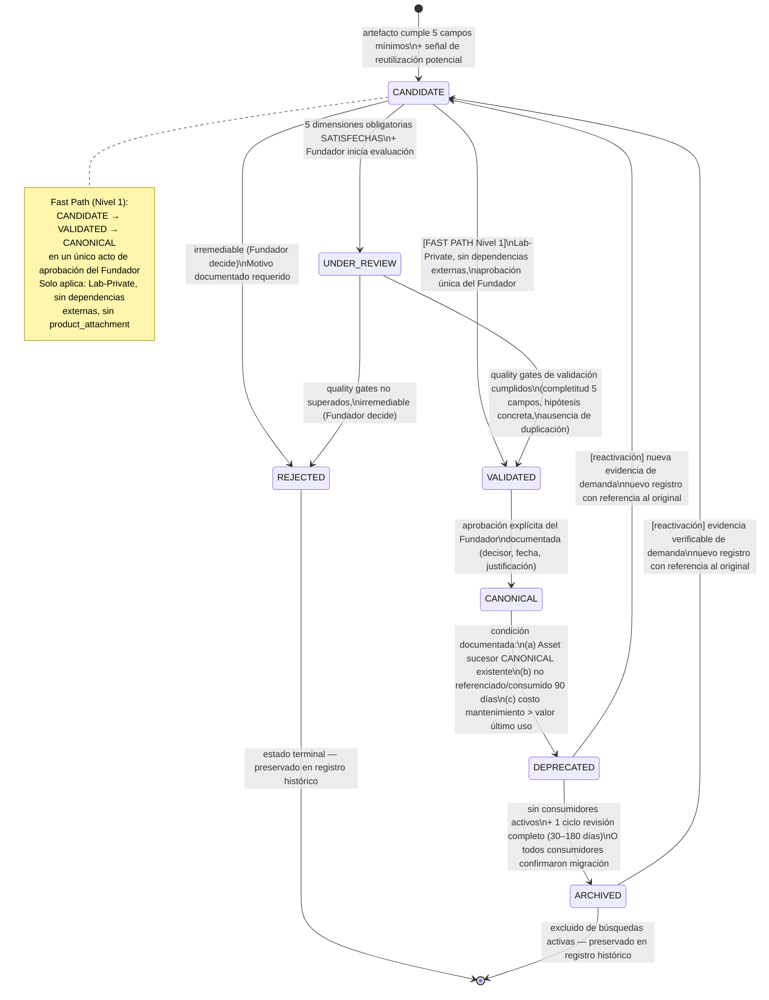
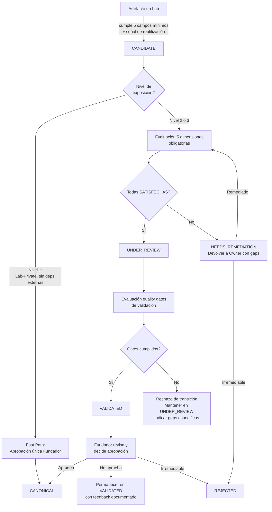

# Design Document

## Metadata

| Campo | Valor |
|-------|-------|
| **Package** | 003 — Asset System |
| **Versión del diseño** | v1.0 |
| **Fecha** | 2026-08-05 |
| **Requirements base** | v1.2 (APPROVED 2026-08-05) |
| **Estado** | DESIGN_READY_FOR_REVIEW |
| **Autor** | Principal Architect (LabOS) |
| **Aprobación fundador** | PENDIENTE |

---

## Introduction

Este documento de diseño traduce los 20 requerimientos aprobados de Package 003 (Asset System v1.2) en una arquitectura documental concreta. El diseño especifica cómo se organizan los 24 documentos planeados, cómo se relacionan entre sí, qué modelos conceptuales gobiernan cada dimensión del Asset System, y cómo los 5 candidatos del Crypto Scalping Core validan el framework antes de su canonización.

**Naturaleza del diseño:** Package 003 produce documentación normativa y workflows operativos — no software, no bases de datos, no APIs. Por tanto, este diseño arquitectónico es un diseño de documentos, modelos conceptuales y procesos de gobernanza, no un diseño de sistema computacional. La sección de Correctness Properties se omite intencionalmente: PBT no aplica a documentación de gobernanza (sin funciones puras, sin inputs/outputs ejecutables). La validación del diseño se realiza mediante matrices de trazabilidad, verificación de consistencia y los 5 candidatos CSC como ejemplos concretos.

**Fuentes autoritativas:** Package 000 README + 007-company-model.md, ADR-0001, ADR-0002, Package 002 knowledge-to-asset-handoff.md, Architecture Baseline v1.0, architecture-change-control-v1.0.md, canonical-domain-map.md.

---

## Overview

Package 003 — Asset System define la arquitectura documental y los modelos conceptuales que gobiernan el ciclo de vida completo de los Assets canónicos de LabOS. El sistema es puramente documental: no implementa software, no crea bases de datos ni APIs.

El diseño comprende tres capas:
1. **Modelo del Asset** — el registro canónico con tres tiers de metadata (intake, promoción, opcional).
2. **Modelo de gobernanza** — el ciclo de vida de 7 estados con dimensiones ortogonales y quality gates proporcionales.
3. **Arquitectura de documentos** — los 24 documentos planificados, sus dependencias y las 5 templates operativas.

Los 5 candidatos del Crypto Scalping Core validan el framework antes de su canonización. Ningún candidato es auto-promovido.

---

## Components and Interfaces

Los componentes de Package 003 son documentos y modelos conceptuales, no módulos de software. Cada componente tiene una interfaz documental con los packages anteriores.

| Componente | Tipo | Interfaz con | Dirección |
|-----------|------|-------------|-----------|
| Asset Record (registro canónico) | Modelo conceptual | Package 000 (5 campos mínimos), Package 002 (knowledge_id), Package 001 (research_id) | Extiende sin redefinir |
| Ciclo de vida de 7 estados | Modelo de gobernanza | Architecture Baseline v1.0, ADR-0002 | Operacionaliza |
| Quality Gates (3 niveles) | Proceso de evaluación | Asset Record, Approval workflow | Governa transiciones |
| Approval workflow | Proceso de decisión | Architecture-change-control-v1.0 | Conforma |
| Knowledge-to-Asset boundary | Interfaz con Package 002 | knowledge-to-asset-handoff.md | Recibe (Package 002 envía) |
| Asset-to-Product boundary | Interfaz con Package 004 | Product Factory (no definido aún) | Envía (Package 004 recibe) |
| Asset Registry (conceptual) | Registro documental | Todos los documentos del Package | Cataloga |
| Templates (5) | Documentos operativos | Asset Record, ciclo de vida | Instrumentan |

---

## Data Models

Package 003 no implementa un modelo de datos en base de datos. El modelo de datos conceptual es el **Asset Record** con tres tiers de metadata (diseñado en detalle en la Sección 2 de la Arquitectura).

**Tier 1 — Intake (9 campos obligatorios al crear un CANDIDATE):**

| Campo | Tipo | Descripción |
|-------|------|-------------|
| asset_id | String (provisional) | Identificador provisional; formato `{LAB}-{TIPO}-{NNN}` al promover |
| nombre | String ≤120 chars | Nombre descriptivo único dentro del Lab |
| tipo | Enum (7 valores) | Uno de: Documento, Template, Dataset, Herramienta, Componente, Framework, Playbook |
| descripción | String ≤500 chars | Qué problema resuelve en 1–3 oraciones |
| hipótesis_de_uso | String | Usuario objetivo + contexto de aplicación |
| originating_Lab | String | Identificador del Lab de origen |
| source_of_truth | String (path/URL) | Ubicación canónica del Asset |
| provenance | String / reference | knowledge_id, research_id o referencia externa |
| fecha_de_creación | ISO 8601 | Fecha de primer registro como CANDIDATE (auto-registrada al crear el CANDIDATE) |

**Tier 2 — Promoción (7 campos adicionales al alcanzar CANONICAL):**

| Campo | Tipo | Descripción |
|-------|------|-------------|
| estado_lifecycle | Enum (7 valores) | CANDIDATE, UNDER_REVIEW, VALIDATED, CANONICAL, DEPRECATED, ARCHIVED, REJECTED |
| versión | SemVer string | MAJOR.MINOR.PATCH; inicia en 1.0.0 |
| asset_id (definitivo) | String | Formato definitivo `{LAB}-{TIPO}-{NNN}`; formaliza el asset_id provisional de Tier 1 |
| Asset_Owner | String | Identificador del responsable humano |
| nivel_de_compartición | Enum (5 valores) | Lab-Private, Lab-Published, LabOS-Shared, Cross-Lab, Public |
| dimensiones_calificación | Object | SATISFECHA/NO_SATISFECHA por cada una de las 5 dimensiones obligatorias (completado ANTES de UNDER_REVIEW) |
| aprobación_fundador | Object | Decisor + fecha + asset_id + justificación (10–280 chars) |

**Tier 3 — Opcional/madurez-dependiente (9 campos):**
consumidores_activos, product_attachments, dependencias, sensibilidad, licensing, fecha_última_revisión, quality_status, costo_mantenimiento_estimado, revenue_thesis.

---

## Architecture

### Sección 1: Document Architecture — Mapa de los 24 Documentos

Esta sección mapea cada documento planificado de Package 003 con sus requerimientos de origen, propósito, fuente de verdad, dependencias y evidencia de validación.


#### 1.1 Tabla Maestra de Documentos

| # | Documento | Requerimientos | Propósito | Fuente de verdad | Dependencias | Evidencia de validación |
|---|-----------|---------------|-----------|-----------------|--------------|------------------------|
| 1 | README.md | R1, R2, R19 | Índice del package, scope, estado, instrucciones de uso | Este documento | ADR-0001, ADR-0002, Package 000 README | Revisión self-review sección 22 |
| 2 | asset-system-principles.md | R1, R19 | Principios que rigen el Asset System sin redefinir conceptos upstream | Package 000 glosario | ADR-0001, Package 000 007-company-model | No contradice glosario canónico |
| 3 | asset-definition-and-boundaries.md | R1, R13, R15, R19 | Distinción formal entre File, Artifact, KO, Asset_Candidate, Asset_Canónico, Capability, Product | Package 000 glosario | knowledge-to-asset-handoff.md, canonical-domain-map.md | 7 entidades × 4 campos cubiertos |
| 4 | asset-taxonomy.md | R2, R19 | Taxonomía canónica de 7 tipos con criterios de distinción y defaults de sharing_scope | ADR-0002 | Package 000 007-company-model.md | Herramienta vs Componente criterion verificado |
| 5 | asset-lifecycle.md | R3, R12, R18 | Ciclo de vida de 7 estados con transiciones, guardas y dimensiones ortogonales | Este documento (R3) | R5 quality gates, R6 ownership | Diagrama Mermaid coherente con R3.11 |
| 6 | asset-qualification-framework.md | R4, R5 | 5 dimensiones obligatorias + 6 recomendadas + 4 dependientes de madurez; Forma A/B | Este documento (R4) | R7 provenance, R6 ownership | Aplicado a 5 candidatos CSC (Sección 19) |
| 7 | asset-promotion-process.md | R3, R5, R18 | Workflow Artifact→Candidate→Evaluation→Founder→Canonical con fast path Nivel 1 | Este documento (R5) | R4 qualification, R18 governance | Fast path ≤20 min validado contra ASSET-3 |
| 8 | asset-ownership.md | R6 | 7 roles con SOLO mapping, transferencia de ownership, Canonical_Authority post cross-Lab | Este documento (R6) | R18 governance | 7 roles × criterios SOLO verificados |
| 9 | asset-source-of-truth.md | R7 | Source_of_truth integrity: cadena de trazabilidad, NEEDS_REMEDIATION trigger | Este documento (R7) | R13 KO integration, Package 002 provenance | Cadena completa 5 eslabones |
| 10 | asset-versioning.md | R8 | MAJOR/MINOR/PATCH para Assets; 3 casos de evolución; supersesión e inmutabilidad | Este documento (R8) | R12 deprecation, R14 product handoff | 3 casos distintos sin ambigüedad |
| 11 | asset-quality-gates.md | R5 | 3 niveles de exposición con gates específicos; fast path; escalación; fallo | Este documento (R5) | R4 qualification, R18 governance | 3 niveles × transitions verificados |
| 12 | asset-sharing-and-reuse.md | R9, R15 | 5 sharing_scope niveles; obligaciones owner y consumer; derivados; conflictos | Este documento (R9) | R6 ownership, R5 quality gates | 5 niveles × obligaciones cubiertos |
| 13 | asset-value-model.md | R10 | DEMOSTRADO/PROYECTADO/INDETERMINADO; 8 dimensiones; sin vanity metrics | Este documento (R10) | R11 metrics, R12 deprecation | 3 estados × criterios de evidencia |
| 14 | asset-metrics.md | R11 | 7 métricas operativas; cadencia de ciclo; trigger de deprecación 2 ciclos; 60 min/ciclo | Este documento (R11) | R10 value model, R12 deprecation | 7 métricas × acción derivada |
| 15 | asset-registry-contract.md | R16 | Modelo conceptual del registro: 3 tiers metadata; reglas de autoridad; sin tecnología | Este documento (R16) | R1 distinction, R3 lifecycle | 8 intake + 8 promotion + 9 optional |
| 16 | knowledge-to-asset-integration.md | R13, R7 | Boundary Package 003 (inicio post-handoff); intake; rechazo; preservación KO | Package 002 handoff | knowledge-to-asset-handoff.md, R7 | Boundary no solapa con Package 002 |
| 17 | asset-to-product-handoff.md | R14 | Elegibilidad product_attachment; 3 tipos contribución; no-transfer ownership; impacto | Este documento (R14) | R6 ownership, Package 004 boundary | No cruza Package 004 boundary |
| 18 | asset-governance.md | R18, R19 | Triggers de aprobación fundador; formatos livianos; campos de aprobación; change control | architecture-change-control-v1.0 | R3 lifecycle, R18 governance | 4 triggers × approval record fields |
| 19 | asset-risk-model.md | R4, R5, R12 | Riesgos por etapa del lifecycle; mitigación; escalación con sharing scope y Product | Este documento | R12 deprecation, R14 product | Riesgos por estado lifecycle |
| 20 | asset-deprecation-and-archive.md | R12 | Triggers deprecación; plan migración; condiciones archivo; reactivación | Este documento (R12) | R11 metrics, R15 labs | Proceso completo ciclo DEPRECATED→ARCHIVED |
| 21 | asset-architecture-diagrams.md | R1–R20 | Diagramas Mermaid del lifecycle, provenance chain, orthogonal dimensions, doc map | Este documento | Todos los documentos anteriores | Consistencia visual con modelo |
| 22 | crypto-scalping-core-asset-candidate-assessment.md | R17 | Evaluación de 5 candidatos CSC contra framework sin auto-promoción ni cambio de código | Este documento (R17) | asset-qualification-framework.md | 5 candidatos × 5 dimensiones × clasificación |
| 23 | package-summary.md | R1–R20 | Resumen ejecutivo del package: scope, entregables, estado, decisiones clave | Este documento | Todos los anteriores | Resumen coherente con requerimientos |
| 24 | package-review.md | R19 | Revisión de cierre: coverage check, no-contradicción con baseline, SOLO proportionality | architecture-change-control-v1.0 | Todos los anteriores | Self-review checklist completo |


#### 1.2 Organización en grupos temáticos

Los 24 documentos se agrupan en 6 clusters funcionales que reflejan la estructura conceptual del Asset System:

**Cluster A — Definición y Taxonomía** (docs 1–4): Establece qué es un Asset, sus tipos y principios. Sin estos, ningún otro documento tiene base terminológica.

**Cluster B — Ciclo de Vida y Proceso** (docs 5–7): Define el ciclo de gobernanza, la calificación y el proceso de promoción. Core operativo del sistema.

**Cluster C — Dimensiones de Soporte** (docs 8–12): Ownership, provenance, versioning, quality gates y sharing. Dimensiones que acompañan al ciclo de vida sin ser estados del mismo.

**Cluster D — Valor y Métricas** (docs 13–14): Modelo de valor sin vanity metrics y métricas operativas del sistema.

**Cluster E — Integraciones y Contratos** (docs 15–20): Registry, handoff con Knowledge y Product, gobernanza, riesgo y deprecación.

**Cluster F — Validación y Cierre** (docs 21–24): Diagramas, validación CSC, resumen y revisión de cierre.

La secuencia de producción recomendada es A → B → C → D → E → F: cada cluster depende del anterior pero no del siguiente.

---

### Sección 2: Canonical Asset Model — Modelo de Registro en 3 Tiers

El Asset Record es la unidad central del Asset System. Se diseña como un registro progresivo: se completa en el intake con el mínimo necesario para funcionar, y se enriquece al momento de la promoción a CANONICAL.

#### 2.1 Tier 1: Metadata Obligatoria de Intake (CANDIDATE)

Estos 8 campos deben estar presentes para registrar un Asset_Candidate. Tiempo estimado: 3–5 minutos.

| Campo | Propósito | Etapa requerida | Owner | Fuente | Validación | Ejemplo | Relaciones |
|-------|-----------|----------------|-------|--------|------------|---------|------------|
| asset_id (provisional) | Identificador provisional único | CANDIDATE | Asset_Owner | Asignado por owner (placeholder si sin formato final) | Formato válido o placeholder documentado | "CSC-HER-001-draft" | Referenciado en provenance de Assets derivados |
| nombre | Identificar el Asset de forma descriptiva | CANDIDATE | Asset_Owner | Asset_Owner | ≤120 caracteres, único en el Lab | "Optimizador de parámetros por grid search con leaderboard" | Vinculado a tipo en registry |
| tipo | Clasificar según taxonomía canónica | CANDIDATE | Asset_Owner | ADR-0002 | Exactamente uno de 7 tipos canónicos | Herramienta | Determina sharing_scope default vía ADR-0002 |
| descripción | Explicar qué problema resuelve | CANDIDATE | Asset_Owner | Asset_Owner | ≤500 caracteres; 1–3 oraciones | "Ejecuta búsqueda exhaustiva de parámetros, evalúa cada combinación vía backtester, genera leaderboard CSV con rankings." | Informa hipótesis_de_uso |
| hipótesis_de_uso | Identificar usuario objetivo y contexto | CANDIDATE | Asset_Owner | Asset_Owner | Usuario objetivo explícito + contexto de aplicación | "Fundador técnico con lab de optimización iterativa que necesita comparar configuraciones de parámetros." | Informa evidencia de reutilización (R4.1) |
| originating_Lab | Registrar Lab de origen | CANDIDATE | Asset_Owner | Lab identifier | Identificador de Lab existente en portafolio | "CryptoScalpingCore" | Determina Canonical_Authority (R6.9) |
| source_of_truth | Declarar ubicación canónica del Asset | CANDIDATE | Asset_Owner | Asset_Owner | Path o URL verificable dentro del repositorio | "crypto-scalping-core/app/optimization/grid_search.py" | Trigger de NEEDS_REMEDIATION si se invalida (R7.5) |
| provenance | Trazabilidad a origen | CANDIDATE | Asset_Owner | KO(s) fuente, research_id, o referencia externa | Al menos 1 referencia verificable (knowledge_id, research_id, o URL/referencia externa) | "research_id: CSC-EXP-014 (grid search optimization study)" | Eslabón Asset→KO(s)→Research de la cadena (R7.4) |

#### 2.2 Tier 2: Metadata Adicional Obligatoria para Promoción a CANONICAL

Estos 8 campos adicionales se completan durante el proceso de evaluación y son necesarios antes de la promoción. Se suman a los 8 de Tier 1.

| Campo | Propósito | Etapa requerida | Owner | Fuente | Validación | Ejemplo | Relaciones |
|-------|-----------|----------------|-------|--------|------------|---------|------------|
| estado_lifecycle | Estado de gobernanza actual | CANONICAL | Asset_System | Determinado por proceso de governance | Uno de: CANDIDATE, UNDER_REVIEW, VALIDATED, CANONICAL, DEPRECATED, ARCHIVED, REJECTED | CANONICAL | Central al ciclo de vida (R3) |
| versión | Versión semántica del Asset | CANONICAL (inicial: 1.0.0) | Asset_Owner | Asset_System (asignado automáticamente) | MAJOR.MINOR.PATCH; inicia en 1.0.0 | 1.0.0 | Referenciada por consumidores para compatibilidad (R8) |
| asset_id (definitivo) | Identificador estable del Asset | CANONICAL | Asset_Owner | Asset_System | Formato {LAB}-{TIPO}-{NNN}; único globalmente | "CSC-HER-001" | Referenciado en product_attachments, derivados, forks |
| Asset_Owner | Responsable de mantenimiento y lifecycle | CANONICAL | Canonical_Authority (Fundador) | Designación del Fundador | Identificador humano (no IA); en SOLO = Fundador | "Fundador" | Trigger de ownership transfer si cambia (R6.8) |
| fecha_de_creación | Fecha de primer registro del Asset (cuándo fue ingresado como CANDIDATE) | CANDIDATE | Asset_System | ISO 8601 auto-registrado al crear el CANDIDATE | Formato ISO 8601 válido | "2026-08-10" | Base de cálculo de ciclos de revisión (R11); se mueve a Tier 1 para capturar la fecha real de ingreso |
| nivel_de_compartición | sharing_scope actual | CANONICAL | Asset_Owner con aprobación Fundador | ADR-0002 default + override explícito | Uno de 5 niveles; cambios requieren aprobación Fundador (R18.1) | "LabOS-Shared" | Determina quality gates aplicables (R5.4) y consumidores (R15) |
| dimensiones_calificación | Resultado de evaluación de 5 dimensiones obligatorias que gate la transición CANDIDATE → UNDER_REVIEW | UNDER_REVIEW | Asset_Owner + reviewer | Evaluación documentada | SATISFECHA / NO_SATISFECHA por dimensión; fecha de evaluación | "evidencia_reuso: SATISFECHA (Forma B); calidad: SATISFECHA..." | Determina si puede avanzar a UNDER_REVIEW (R4.4) — debe completarse ANTES de la transición CANDIDATE → UNDER_REVIEW |
| aprobación_fundador | Registro de aprobación para CANONICAL | CANONICAL | Fundador | Decisión explícita documentada | Decisor + fecha + Asset afectado + justificación 10–280 chars | "Aprobado 2026-08-15: ASSET-3 cumple fast path Nivel 1, Forma B con trigger 90d" | Requerida para transición VALIDATED→CANONICAL (R18.1) |

#### 2.3 Tier 3: Metadata Opcional / Dependiente de Madurez

Estos 9 campos son opcionales o se vuelven relevantes cuando el Asset alcanza ciertos niveles de madurez o sharing_scope.

| Campo | Propósito | Condición de relevancia | Owner | Ejemplo |
|-------|-----------|------------------------|-------|---------|
| consumidores_activos | Lista de Labs o Products que referencian el Asset | Cuando sharing_scope ≥ LabOS-Shared | Asset_Owner | ["AtlasWealthLabs", "LabOS"] |
| product_attachments | Products asociados al Asset | Cuando existe product_attachment activo | Asset_Owner + Fundador | [{"product_id": "P001", "tipo": "core", "fecha": "2026-09-01"}] |
| dependencias | Asset_ids de Assets de los que depende | Cuando el Asset usa otros Assets | Asset_Owner | ["CSC-DOC-001", "LOS-FRM-001"] |
| sensibilidad | Clasificación de sensibilidad de la información | Cuando sharing_scope ≥ Cross-Lab (obligatorio en ese tier) | Asset_Owner | "interna" |
| licensing | Tipo de licencia aplicable | Cuando sharing_scope ≥ Cross-Lab (obligatorio en ese tier) | Asset_Owner | "MIT" / "LabOS-Internal-v1" |
| fecha_última_revisión | Fecha de última revisión de quality o valor | Útil para tracking de ciclo | Asset_Owner | "2026-11-01" |
| quality_status | Estado de evaluación formal de quality gates | Distinto del lifecycle state; registro de evaluación | Asset_Owner | "validado" (sin_evaluar / en_revisión / validado / rechazado) |
| costo_mantenimiento_estimado | Estimación de horas/mes de mantenimiento activo | Cuando se evalúa deprecación o product_attachment | Asset_Owner | 2 (horas/mes) |
| revenue_thesis | Hipótesis de monetización con 3 campos mínimos | Obligatorio para product_attachment (R14.1) | Asset_Owner | {"segmento": "labs de trading cuantitativo", "formato": "open-source + soporte", "modelo": "licencia"} |


---

### Sección 3: Lifecycle Model — Ciclo de Vida de 7 Estados

#### 3.1 Diagrama de Estados



#### 3.2 Definición de cada estado

| Estado | Significado | Quién puede entrar | Transiciones válidas salientes |
|--------|-------------|-------------------|-------------------------------|
| CANDIDATE | Artefacto propuesto como reutilizable; cumple 5 campos mínimos + señal de reutilización | Cualquier artefacto que cumple R1.2 y R3.2 | → UNDER_REVIEW, → REJECTED, → VALIDATED (fast path) |
| UNDER_REVIEW | En evaluación activa por el Fundador; 5 dimensiones obligatorias en proceso de verificación | CANDIDATE que inicia evaluación (R3.3) | → VALIDATED, → REJECTED |
| VALIDATED | Cumple todas las quality gates de validación; pendiente de aprobación final del Fundador | UNDER_REVIEW con gates cumplidos (R3.4); CANDIDATE en fast path | → CANONICAL |
| CANONICAL | Aprobado formalmente por el Fundador; gobernado activamente; disponible para consumo según sharing_scope | VALIDATED con aprobación explícita (R3.5) | → DEPRECATED |

**Nota — VALIDATED sin promoción (path de abandono):** Si el Fundador decide no promover un Asset VALIDATED y desea retirarlo del pipeline sin que exista un sucesor canónico, el Asset puede permanecer en VALIDATED indefinidamente hasta que el Fundador tome una decisión. No existe una transición directa VALIDATED → CANDIDATE; si el Fundador quiere eventualmente reactivarlo bajo una nueva evaluación, deberá crear un **nuevo registro de CANDIDATE** con referencia al Asset VALIDATED original. Esta decisión debe documentarse en el registro del Asset original con justificación (incluso si es "diferido sin fecha"). Esta nota cierra el gap identificado en OPT-03 del requirements review.
| DEPRECATED | En proceso de retiro con plan de migración; aún accesible para consumidores existentes | CANONICAL con condición documentada (R3.6, R12.1) | → ARCHIVED, → CANDIDATE (reactivación) |
| ARCHIVED | Retirado del registro activo; preservado históricamente; excluido de búsquedas de Assets disponibles | DEPRECATED sin consumidores o con migraciones confirmadas (R3.7, R12.4) | → CANDIDATE (reactivación con nuevo registro) |
| REJECTED | Evaluación terminada negativamente; irremediable; preservado históricamente | CANDIDATE o UNDER_REVIEW con decisión Fundador (R3.8) | Ninguna (terminal) |

#### 3.3 Transiciones inválidas

Las siguientes transiciones están explícitamente prohibidas (R3.11, R3.12):

- CANONICAL → VALIDATED, CANONICAL → UNDER_REVIEW, CANONICAL → CANDIDATE
- DEPRECATED → VALIDATED, DEPRECATED → CANONICAL
- ARCHIVED → CANONICAL, ARCHIVED → VALIDATED, ARCHIVED → UNDER_REVIEW
- REJECTED → cualquier estado (terminal absoluto)
- Cualquier transición no listada en la tabla 3.2

Si se intenta una transición inválida, el Asset_System rechaza la transición, indica el estado actual y lista las transiciones válidas disponibles.

#### 3.4 Guardas de transición

| Transición | Guardas obligatorias |
|-----------|---------------------|
| CANDIDATE → UNDER_REVIEW | 5 dimensiones obligatorias SATISFECHAS (R4.5); Fundador inicia revisión |
| UNDER_REVIEW → VALIDATED | 5 campos mínimos completos y verificados; hipótesis de uso con escenario concreto; sin duplicación con Asset VALIDATED/CANONICAL (R3.4) |
| VALIDATED → CANONICAL | Aprobación explícita Fundador con campos completos: decisor, fecha, Asset afectado, justificación 10–280 chars (R18.1, R18.3) |
| CANONICAL → DEPRECATED | Al menos 1 condición documentada de R12.1; justificación registrada; notificación a consumidores activos últimos 180 días |
| DEPRECATED → ARCHIVED | Sin consumidores activos O todos confirmaron migración; mínimo 30 días desde fecha deprecación; máximo 180 días o forzar decisión (R12.4, R12.7) |
| CANDIDATE → VALIDATED (fast path) | sharing_scope Lab-Private; sin dependencias externas; sin product_attachment; aprobación única Fundador (R3.10, R5.5) |

#### 3.5 Dimensiones ortogonales (NO son estados del ciclo de vida)

Las siguientes tres dimensiones son atributos del Asset Record que existen independientemente del lifecycle state. Un Asset puede ser CANONICAL y Lab-Private simultáneamente. El flag review_required puede activarse sobre un Asset en cualquier lifecycle state sin modificarlo.

| Dimensión | Valores | Owner del cambio | Trigger de cambio | Impacto en lifecycle |
|-----------|---------|-----------------|-------------------|---------------------|
| sharing_scope | Lab-Private, Lab-Published, LabOS-Shared, Cross-Lab, Public | Asset_Owner + Fundador | Decisión explícita del Fundador (R18.1); default por tipo (ADR-0002) | Ninguno directo; determina quality gates (R5.4) |
| product_attachment | null / {product_id, tipo, fecha} | Asset_Owner + Fundador | Vinculación explícita cuando Asset cumple R14.1 | Ninguno; eleva nivel de exposición a Nivel 3 (R5.4) |
| review_required | false / {motivo, fecha, KO_id} | Asset_System (activación automática); Asset_Owner (resolución) | KO fuente superseded/deprecated/MAJOR; Forma B a 90 días (R4.6, R20) | Ninguno — lifecycle state permanece sin cambios |


---

### Sección 4: Orthogonal Dimensions Design

Las tres dimensiones ortogonales (sharing_scope, product_attachment, review_required) son independientes del lifecycle state y entre sí. Esta sección diseña cada una en detalle.

#### 4.1 sharing_scope

**Propósito:** Controla quién puede acceder y consumir el Asset. No gobierna la madurez de gobernanza.

| Nivel | Significado | Default para tipos | Quién puede cambiar | Aprobación Fundador |
|-------|-------------|-------------------|--------------------|--------------------|
| Lab-Private | Solo el Lab de origen tiene acceso | Componente, Playbook | Asset_Owner + solicitud al Fundador | Requerida para subir de nivel |
| Lab-Published | Publicado voluntariamente por el Lab; otros Labs pueden referenciar en modo lectura | — (no default) | Asset_Owner con aprobación Fundador | Sí |
| LabOS-Shared | Infraestructura transversal mantenida por LabOS; accesible por todos los Labs | Documento, Template, Dataset, Herramienta, Framework | Asset_Owner con aprobación Fundador | Sí |
| Cross-Lab | Co-creado entre Labs participantes con acuerdo de co-propiedad documentado | — (requiere proceso explícito) | Fundador + Labs participantes | Sí (R18.1) |
| Public | Accesible externamente fuera del ecosistema LabOS | — (requiere proceso explícito) | Fundador | Sí (R18.1) — máxima aprobación |

**Relación con sensibilidad:** Assets con sensibilidad "confidencial" no pueden superar Lab-Private sin revisión explícita. Assets con sensibilidad "interna" pueden alcanzar Cross-Lab con evaluación de sensibilidad (R5.2).

**Relación con quality level:** Subir de sharing_scope activa quality gates adicionales (R5 Nivel 2 / Nivel 3). No es posible publicar a Cross-Lab o Public sin documentación de uso, licencia y evaluación de sensibilidad.

**Relación con ownership:** La Canonical_Authority del originating_Lab persiste después de cualquier cambio de sharing_scope (R6.9). Un cambio de sharing_scope no transfiere autoridad canónica.

#### 4.2 product_attachment

**Propósito:** Registra que un Asset CANONICAL contribuye a un Product específico. Es una asociación externa — no modifica el lifecycle del Asset ni transfiere su ownership.

**Relaciones:**
- Con lifecycle state: Solo Assets en estado CANONICAL son elegibles (R14.1).
- Con ownership: Asset_Owner retiene responsabilidad; Product no adquiere ownership del Asset.
- Con quality level: Activa automáticamente Nivel 3 de exposición (R5.4), requiriendo gates adicionales.
- Con Product dependencies: Cambios MAJOR o deprecación del Asset requieren evaluación de impacto en Products dependientes (R14.4).

**Tipos de contribución:**

| Tipo | Significado | Impacto si el Asset se depreca |
|------|-------------|-------------------------------|
| core | Funcionalidad principal; el Product no opera sin este Asset | Product se interrumpe; migración obligatoria antes de deprecar |
| supporting | Funcionalidad que mejora el Product; no es indispensable | Product degrada funcionalidad; plan de migración requerido |
| optional | Funcionalidad complementaria removible sin degradar | Product no afectado; notificación suficiente |

#### 4.3 review_required

**Propósito:** Señaliza que el Asset_Owner debe revisar el Asset debido a un cambio en una dependencia upstream o al vencimiento de un trigger programado. NO es un estado del ciclo de vida.

| Trigger | Motivo registrado | Acción del Asset_Owner | Plazo |
|---------|-------------------|----------------------|-------|
| KO fuente → superseded | "KO fuente superseded: {ko_id}" | Evaluar si el Asset sigue siendo válido sin el KO original | Sin plazo automático; evaluado en próximo ciclo |
| KO fuente → deprecated | "KO fuente deprecated: {ko_id}" | Evaluar si tiene validación independiente; considerar deprecación | Sin plazo automático |
| KO fuente → versión MAJOR | "KO fuente cambió versión MAJOR: {ko_id} {v_old}→{v_new}" | Evaluar si el cambio invalida el Asset o es compatible | Sin plazo automático |
| Forma B a 90 días | "evidencia de reutilización Forma B — review a 90 días" | Documentar evidencia real de uso (Forma A) o escalar evaluación de deprecación | 30 días para decidir acción (R10.4) |
| KO fuente → disputed | review flag informativo (no review_required) | Discrecional del Asset_Owner | — |

**Resolución:** El Asset_Owner decide la acción resultante: actualizar el Asset, mantenerlo sin cambios con justificación documentada, o iniciar el proceso de deprecación. Una vez resuelta la revisión, el flag review_required se limpia con registro de la decisión tomada.

---

### Sección 5: Qualification and Promotion Design

#### 5.1 Flujo completo de Artifact → Canonical Asset



#### 5.2 Dimensiones de calificación obligatorias (5)

| # | Dimensión | Criterio de SATISFECHA | Forma A | Forma B | Bloqueo si NO_SATISFECHA |
|---|-----------|----------------------|---------|---------|--------------------------|
| 1 | Evidencia de reutilización | Ver Forma A o Forma B | ≥1 uso documentado fuera del contexto de origen (fecha + contexto + resultado) | Declaración escrita con ≥1 Lab/dominio destino específico + ≥1 escenario concreto; activa review trigger a 90 días | Sí — impide UNDER_REVIEW (R4.4) |
| 2 | Calidad mínima documentable | 5 campos mínimos completos + ≥1 validación registrada por el owner | — | — | Sí |
| 3 | Provenance trazable | Origen identificado con referencia verificable (knowledge_id, research_id, URL/referencia externa) | — | — | Sí |
| 4 | Ownership asignado | Owner nombrado explícitamente como responsable de mantenimiento y lifecycle | — | — | Sí |
| 5 | Source of truth identificado | Ubicación canónica única declarada dentro del repositorio; path o URL verificable | — | — | Sí |

#### 5.3 Dimensiones recomendadas (6) — no bloquean

| Dimensión | Registro | Valor para decisión |
|-----------|----------|---------------------|
| Repetibilidad | PRESENTE / AUSENTE | Alta si el proceso es ejecutable múltiples veces con resultados consistentes |
| Mantenibilidad | PRESENTE / AUSENTE | Alta si el Asset puede actualizarse sin rediseño completo |
| Documentación de uso | PRESENTE / AUSENTE | Crítica para Cross-Lab (se vuelve obligatoria ahí) |
| Estabilidad de dependencias | PRESENTE / AUSENTE | Relevante para product_attachment |
| Valor medible | PRESENTE / AUSENTE | Informa modelo de valor (Sección 11) |
| Aplicabilidad cross-Lab | PRESENTE / AUSENTE | Determina si tiene potencial más allá del Lab de origen |

#### 5.4 Dimensiones dependientes de madurez (4)

Solo se evalúan cuando el owner declara intención de Cross-Lab o product_attachment:

| Dimensión | Cuando aplica | Contenido de la evaluación |
|-----------|--------------|---------------------------|
| Sensibilidad y licensing | sharing_scope ≥ Cross-Lab | Clasificación (pública/interna/confidencial) + tipo de licencia seleccionada |
| Relevancia de Product | product_attachment declarado | Tipo de contribución + Revenue_Thesis con 3 campos mínimos |
| Costo operativo | sharing_scope Cross-Lab o product_attachment | Estimación horas/mes de mantenimiento |
| Diferenciación estratégica | sharing_scope Public | Por qué este Asset es valioso para audiencias externas |

#### 5.5 Rechazo, remediación y re-review

**Clasificación NEEDS_REMEDIATION:** Se asigna cuando ≥1 dimensión obligatoria tiene estado NO_SATISFECHA pero es potencialmente subsanable. El sistema devuelve el candidato al owner con los gaps específicos por dimensión y las acciones de remediación requeridas.

**Clasificación REJECTED:** Se asigna cuando (a) el candidato no cumple la definición de Asset, (b) tiene ≥3 dimensiones NO_SATISFECHA sin ruta de remediación viable, o (c) el Fundador determina que el esfuerzo de remediación no justifica la inversión.

**Re-review:** Un Asset en NEEDS_REMEDIATION puede re-iniciar el proceso de evaluación una vez completadas las remediaciones documentadas. No hay límite de intentos, pero cada intento debe documentar las remediaciones aplicadas.

**No existe promoción automática:** En ningún escenario un Asset avanza de estado sin decisión explícita del Fundador. Los sistemas automatizados pueden verificar precondiciones pero no ejecutar la transición.


---

### Sección 6: Ownership Design

#### 6.1 Los 7 roles conceptuales

| Rol | Definición | Autoridad sobre | Restricciones |
|-----|-----------|-----------------|---------------|
| creator | Quien produce el artefacto original | Producción del artefacto | No es necesariamente Asset_Owner; distinto de ownership (R6.2) |
| originating_Lab | Lab donde se origina el Asset | Contexto de origen; fuente de Canonical_Authority inicial | No cambia post-publicación salvo co-governance via ADR |
| Asset_Owner | Responsable de mantenimiento y lifecycle | Decisiones de mantenimiento, versioning, evaluaciones | Solo humanos; en SOLO = Fundador (R6.4) |
| maintainer | Ejecutor de actualizaciones técnicas del Asset | Cambios técnicos al contenido del Asset | Puede ser IA bajo supervisión del Asset_Owner humano (R6.4) |
| reviewer | Evaluador de quality gates | Evaluación de dimensiones de calificación | Puede ser IA bajo supervisión del Asset_Owner humano (R6.4) |
| Canonical_Authority | Decisor de promoción, deprecación y cambios de sharing_scope | Decisiones de governance más críticas | Solo humanos; en SOLO = Fundador (R6.3) |
| consumer | Usuario del Asset | Consumo referenciando el source_of_truth | Obligaciones de atribución, compatibilidad, notificación de defectos (R9.5) |

**Distinción clave:** ownership ≠ authorship ≠ Canonical_Authority. Los tres roles se registran independientemente.

#### 6.2 Mapping en modo SOLO

En contexto SOLO (1 Fundador operador), el Fundador puede ocupar simultáneamente los roles de: creator, Asset_Owner, maintainer, reviewer y Canonical_Authority. Esto es un hecho operativo del contexto, no una relajación del modelo de roles. Los roles siguen siendo conceptualmente distintos y deben registrarse por separado para preparar el escalamiento futuro.

| Rol | Fundador SOLO | AI permitida bajo supervisión |
|-----|--------------|-------------------------------|
| creator | ✅ Sí | Puede co-crear contenido |
| originating_Lab | N/A (atributo del Lab, no persona) | — |
| Asset_Owner | ✅ Sí | ❌ No |
| maintainer | ✅ Sí | ✅ Sí (bajo supervisión del Fundador como Asset_Owner) |
| reviewer | ✅ Sí | ✅ Sí (bajo supervisión del Fundador como Asset_Owner) |
| Canonical_Authority | ✅ Sí | ❌ No |
| consumer | ✅ Sí (cuando usa sus propios Assets) | — |

#### 6.3 Protocolo de transferencia de ownership

Cuando el Asset_Owner de un Asset necesita cambiar, se requiere un registro de transferencia con los siguientes campos (R6.8):

1. Asset identificado (asset_id definitivo)
2. Asset_Owner saliente (identificador)
3. Asset_Owner entrante (identificador humano)
4. Fecha de transferencia (ISO 8601)
5. Confirmación explícita del nuevo Asset_Owner aceptando responsabilidad de mantenimiento y lifecycle

La transferencia no requiere aprobación del Fundador en contexto SOLO (el Fundador ES el Asset_Owner), pero el registro debe existir para trazabilidad.

#### 6.4 Canonical_Authority post cross-Lab promotion

La Canonical_Authority del originating_Lab retiene autoridad canónica sobre el Asset después de cualquier cambio de sharing_scope, incluyendo Cross-Lab y Public. Este diseño:

- Previene apropiaciones de facto por Labs consumidores
- Mantiene accountability clara sobre decisiones de governance
- Prepara el escalamiento sin romper la estructura actual

Un cambio de Canonical_Authority hacia co-governance o autoridad compartida con otro Lab requiere un ADR formal que establezca el nuevo modelo de gobernanza, conforme al architecture-change-control-v1.0 (clasificado como MAJOR si altera el modelo de gobernanza).

---

### Sección 7: Provenance and Source of Truth Design

#### 7.1 Cadena de provenance

El diseño establece una cadena de trazabilidad de 5 eslabones. Cada eslabón debe contener una referencia verificable (ID o path) al eslabón anterior:

```
Asset → Knowledge_Object(s) → Research → Evidence → Source
```

| Eslabón | Identificador | Verificable mediante | Custodia |
|---------|--------------|---------------------|---------|
| Asset | asset_id | Registry de Package 003 | Asset_Owner |
| Knowledge_Object(s) | knowledge_id (Package 002) | KO registry de Package 002 | KO Owner |
| Research | research_id (Package 001) | Research log de Package 001 | Lab |
| Evidence | Referencia en KO (experiment log, dataset, análisis) | Documento referenciado | Lab |
| Source | URL, referencia bibliográfica, path de dataset | Directamente accesible | Externo / Lab |

#### 7.2 Tres tipos de fuente (R7.1, R7.6)

| Tipo de fuente | Cuándo aplica | Campo de provenance | Nota |
|----------------|--------------|---------------------|------|
| KO registrado | Asset originado en KO(s) formalizados en Package 002 | knowledge_id(s) válidos | Camino preferido; completa la cadena |
| research_id | Asset originado en investigación propia no formalizada como KO | research_id de Package 001 + motivo de ausencia de KO | Cubre el path Research→Asset directo (canonical-domain-map.md) |
| Referencia externa | Asset originado en fuentes externas sin KO registrado | URL, referencia bibliográfica o identificador externo | Para Assets basados en contenido de terceros |

#### 7.3 Integridad del source_of_truth

El source_of_truth es una ubicación canónica única. El diseño establece las siguientes reglas:

- Un Asset tiene **exactamente un** source_of_truth (R7.2).
- El source_of_truth está dentro del repositorio de LabOS o referenciado como recurso externo identificado.
- La compartición basada en referencia (no en copia) garantiza que todos los consumidores apuntan al mismo source_of_truth (R9.4).
- Cualquier copia local detectada se clasifica como Asset derivado (R9.7).

#### 7.4 Trigger NEEDS_REMEDIATION

Cuando el source_of_truth se vuelve inaccesible (path inválido, repositorio eliminado, recurso inaccesible), el Asset se marca automáticamente como NEEDS_REMEDIATION con motivo "source_of_truth inaccesible: {path}". El Asset permanece en este estado hasta que se restaure una referencia válida y verificable. El lifecycle state del Asset NO cambia automáticamente, pero el Asset queda inelegible para nuevas vinculaciones (product_attachment) mientras el NEEDS_REMEDIATION esté activo.

#### 7.5 Registro de versiones (historial inmutable)

El historial de versiones del Asset es un registro independiente de Git y es inmutable (R7.3, R8.5). Cada entrada contiene:

- Número de versión (MAJOR.MINOR.PATCH)
- Fecha del cambio (ISO 8601)
- Descripción del cambio (10–500 caracteres)
- Autor del cambio (identificador del Fundador o contribuidor)

Las entradas existentes no pueden ser eliminadas ni modificadas una vez registradas. Git provee historial técnico pero no reemplaza este registro de versiones semántico.

---

### Sección 8: Versioning Design

#### 8.1 Semántica de versiones para Assets

El versionado semántico MAJOR.MINOR.PATCH se define específicamente para Assets de gobernanza de conocimiento, no solo para software:

| Tipo de cambio | Definición | Ejemplo |
|---------------|-----------|---------|
| PATCH | Correcciones que no alteran funcionalidad ni interfaz: typos, links, clarificaciones de redacción sin cambio semántico | "Corregir descripción de parámetro" |
| MINOR | Adiciones compatibles que no rompen uso existente: nuevo ejemplo, nueva sección opcional, ampliación del scope sin modificar lo existente | "Añadir ejemplo de uso en Atlas Wealth Labs" |
| MAJOR | Cambios incompatibles que requieren adaptación por consumidores: cambio de interfaz pública, cambio de propósito fundamental, reestructuración que rompe compatibilidad | "Cambiar estructura de output del optimizador a formato incompatible con versión anterior" |

La versión inicial al momento de promoción a CANONICAL es siempre 1.0.0 (R8.6).

#### 8.2 Tres casos de evolución

En todos los casos, el Asset original permanece sin cambios.

| Caso | Cuándo | Resultado | Identidad |
|------|--------|-----------|-----------|
| Nueva versión | Mismo propósito, misma audiencia fundamental, cambio incremental o breaking | Mismo asset_id, versión incrementada (MAJOR/MINOR/PATCH) | Continuidad de identidad |
| Asset derivado | Asset modificado desde un Asset compartido para un contexto específico | Nuevo asset_id + provenance que referencia: identificador original, versión base, descripción de modificaciones | Identidad nueva con linaje declarado |
| Fork | Copia independiente para desarrollo nuevo e independiente, sin intención de mantener compatibilidad con el original | Nuevo asset_id + provenance que referencia original | Identidad nueva con origen declarado |

**Criterio de nueva versión vs nuevo Asset:** Si el cambio propuesto altera el propósito fundamental del Asset (de forma que consumidores actuales no puedan usarlo para su finalidad original), se requiere un nuevo Asset en lugar de una nueva versión MAJOR (R8.4).

#### 8.3 Supersesión

Cuando un cambio MAJOR reemplaza completamente la funcionalidad de la versión anterior y ningún consumidor debería seguir usando la versión old:

1. La versión anterior se marca como SUPERSEDED con referencia al asset_id/versión sucesor.
2. La versión anterior permanece en el registro histórico.
3. Los consumidores activos reciben notificación con 14 días de anticipación (R9.6).
4. Período de gracia de 30 días antes de completar la deprecación de la versión old.

#### 8.4 Impacto de versiones en dependencias de Product

| Tipo de versión | Impacto en product_attachment | Acción requerida |
|----------------|------------------------------|-----------------|
| PATCH | Sin impacto | Notificación informativa opcional |
| MINOR | Sin impacto funcional | Notificación opcional; actualizar referencia de versión recomendada |
| MAJOR | Impacto potencial | Evaluación de impacto obligatoria (R14.4); notificación 14 días antes; período de gracia 30 días |


---

### Sección 9: Quality Gates Design

#### 9.1 Los 3 niveles de exposición

| Nivel | Criterio de clasificación | Quality gates requeridos |
|-------|--------------------------|------------------------|
| Nivel 1 | sharing_scope Lab-Private + sin dependencias externas + sin product_attachment | Fast path: 5 campos mínimos completos, ≥1 referencia de uso dentro del Lab, aprobación Fundador |
| Nivel 2 | sharing_scope Lab-Published, LabOS-Shared o Cross-Lab; con dependencias de otros Labs | Gates de Nivel 1 + documentación de uso (propósito, instrucciones, dependencias, ejemplo), licencia explícita, evaluación de sensibilidad, confirmación de mantenibilidad (responsable + frecuencia) |
| Nivel 3 | product_attachment activo O sharing_scope Public | Gates de Nivel 2 + estabilidad demostrada (sin cambios MAJOR en ≥1 ciclo de revisión, mínimo 30 días), ownership explícito con identidad registrada, plan de mantenimiento con frecuencia y criterios de deprecación, evaluación de impacto ante deprecación |

> **Nota DC5 — Override de riesgo:** El modelo de 3 niveles de exposición es el mecanismo principal de graduación de quality gates. Sin embargo, un Asset de cualquier nivel de exposición puede requerir evaluación elevada cuando involucra uno o más de los siguientes factores: (a) **datos de origen externo con licencia** (tipo Dataset derivado de fuentes licenciadas — aplica evaluación de licensing independientemente del nivel); (b) **impacto financiero** — si el Asset informa decisiones de trading, inversión o métricas de negocio con impacto económico real; (c) **información de seguridad o autenticación**; (d) **impacto sobre clientes externos**. En estos casos, el Fundador debe aplicar manualmente la evaluación de sensibilidad y licensing (gates de Nivel 2/3) incluso si el Asset es formalmente Nivel 1. Esta es una excepción de risk override aplicada por juicio del Fundador, no un gate automático.

#### 9.2 Fast path (Nivel 1) — detalle

El fast path permite que un Asset Lab-Private sin exposición externa recorra CANDIDATE → VALIDATED → CANONICAL mediante una única aprobación del Fundador que cubre simultáneamente las quality gates de validación y la aprobación final. No existe una evaluación de 5 dimensiones independiente: el Fundador verifica todo en el mismo acto documentado.

**Criterios de elegibilidad para fast path:**
- sharing_scope Lab-Private (default para Componente y Playbook; explícito para otros tipos)
- Sin dependencias a recursos de otros Labs
- Sin product_attachment activo o declarado
- Sin consumidores externos al Lab de origen

**Output del fast path:** Un registro de aprobación única con: fecha, asset_id provisional, clasificación como Nivel 1, confirmación de 5 campos mínimos, confirmación de ≥1 referencia de uso interno, justificación (10–280 chars).

#### 9.3 Escalación automática de Nivel 1 a Nivel 2

Si un Asset clasificado como Nivel 1 adquiere una dependencia cross-Lab o se vincula a un Product, el Asset_System reclasifica automáticamente el Asset al nivel de exposición correspondiente y requiere que el Asset_Owner complete los quality gates del nuevo nivel antes de que la operación (compartición o vinculación) sea permitida (R5.7).

La reclasificación no invalida el Asset ni revierte su estado CANONICAL. Solo impone la evaluación de gates adicionales antes de proceder con la operación que eleva la exposición.

#### 9.4 Gate failure behavior

Cuando un Asset no cumple los criterios de un quality gate durante una evaluación de promoción:

1. La transición es rechazada.
2. El sistema indica cuáles criterios específicos no fueron satisfechos (por nombre, no solo por número).
3. El Asset permanece en su estado actual sin pérdida de metadata registrada.
4. El Asset_Owner puede corregir los gaps y reintentar la evaluación.
5. Si el Fundador determina que los gaps son irremediables, el Asset transiciona a REJECTED con motivo documentado.

#### 9.5 Gates para transiciones específicas

| Transición | Nivel | Gate principal | Gate adicional Nivel 2/3 |
|-----------|-------|---------------|--------------------------|
| CANDIDATE → UNDER_REVIEW | 1/2/3 | 5 dimensiones obligatorias SATISFECHAS | Nivel 2+: documentación de uso comenzada |
| UNDER_REVIEW → VALIDATED | 1/2/3 | 5 campos completos + hipótesis concreta + sin duplicación | Nivel 2+: licencia, sensibilidad evaluadas |
| VALIDATED → CANONICAL | 1 | Aprobación Fundador única | — |
| VALIDATED → CANONICAL | 2 | Aprobación Fundador + documentación de uso completa + mantenibilidad confirmada | — |
| VALIDATED → CANONICAL | 3 | Aprobación Fundador + gates Nivel 2 + estabilidad demostrada + plan de mantenimiento | — |
| CANONICAL → sharing_scope Cross-Lab/Public | 2/3 | Autorización explícita Asset_Owner + originating_Lab | Evaluación de impacto si hay product_attachment |
| CANONICAL → product_attachment | 3 | Elegibilidad completa R14.1 | Evaluación de impacto con lista de dependientes |

---

### Sección 10: Sharing and Reuse Design

#### 10.1 Cinco niveles de sharing_scope

El diseño establece que el sharing es **basado en referencia**, no en copia. Los consumidores referencian el source_of_truth del Asset; no crean copias locales independientes (R9.4).

| Nivel | Acceso | Publicación por default | Proceso para subir de nivel |
|-------|--------|------------------------|----------------------------|
| Lab-Private | Solo originating_Lab | Componente, Playbook | Publicación explícita vía Asset_Sharing_Protocol con aprobación Fundador |
| Lab-Published | Labs que buscan activamente; modo lectura | — | Declaración explícita del Asset_Owner con aprobación Fundador |
| LabOS-Shared | Todos los Labs del ecosistema | Documento, Template, Dataset, Herramienta, Framework | Documentación de uso completa + mantenibilidad confirmada + aprobación Fundador |
| Cross-Lab | Labs co-creadores + ecosistema con acuerdo | — | Acuerdo de co-propiedad documentado + gates Nivel 2 + aprobación Fundador |
| Public | Cualquier persona fuera de LabOS | — | Gates Nivel 3 + evaluación de sensibilidad + licencia seleccionada + aprobación Fundador |

#### 10.2 Obligaciones del consumidor (R9.5)

1. **Atribución:** Identificar el Asset de origen con su asset_id y Lab propietario en cualquier trabajo que lo referencie.
2. **Verificación de compatibilidad:** Registrar la versión referenciada y confirmar prueba en el contexto propio antes de usar el Asset en producción.
3. **Notificación de defectos:** Comunicar al Asset_Owner cualquier defecto encontrado. En contexto SOLO esta obligación se simplifica a registrar el defecto en el Asset record.

#### 10.3 Obligaciones del Asset_Owner hacia consumidores (R9.6)

1. **Notificación de cambios MAJOR:** Mínimo 14 días calendario de anticipación cuando hay ≥1 consumidor activo.
2. **Período de gracia:** 30 días calendario antes de completar una deprecación cuando hay ≥1 consumidor activo.
3. **Documentación de migración:** Obligatoria cuando el Asset tiene ≥1 consumidor activo y se depreca.

#### 10.4 Manejo de Assets derivados

Cuando un consumidor modifica un Asset compartido para su contexto específico, el resultado es un **Asset derivado** — una nueva entidad con su propio lifecycle. El Asset derivado debe registrar en su provenance:

- Identificador del Asset original
- Versión base utilizada
- Descripción de las modificaciones realizadas

El Asset original permanece sin cambios: continúa CANONICAL, versionado e inmutable.

#### 10.5 Referencias obsoletas (stale references)

La compartición es basada en referencia (Sección 10.1). Cuando un Asset es actualizado (nueva versión registrada) o tiene una versión marcada como SUPERSEDED, los consumidores que referenciaban esa versión deben ser notificados:

| Evento | Notificación a consumidores | Acción del consumidor |
|--------|-----------------------------|-----------------------|
| Versión MINOR o PATCH publicada | Opcional — informativa | Actualizar referencia de versión si se desea (sin obligación) |
| Versión MAJOR publicada | Obligatoria — 14 días de anticipación (R9.6) | Evaluar compatibilidad; actualizar si es necesario dentro del período de gracia (30 días) |
| Versión marcada SUPERSEDED | Obligatoria — junto con la publicación de la versión sucesora | Migrar a la versión sucesora antes de que el período de gracia expire |

**Regla de coexistencia:** Un consumidor puede continuar referenciando una versión anterior de un Asset (incluso si existe una versión más nueva), mientras esa versión no haya sido marcada como SUPERSEDED ni el Asset haya sido DEPRECATED. La referencia a una versión específica es responsabilidad del consumidor y debe documentarse en su registro de compatibilidad.

**Versión superseded con dependencias activas:** Antes de marcar una versión como SUPERSEDED, el Asset_Owner debe verificar qué consumidores (y qué product_attachments) referencian esa versión específica. Si existen product_attachments activos referenciando la versión a SUPERSEDER, se requiere evaluación de impacto idéntica a la de un cambio MAJOR antes de completar la supersesión (ver Sección 8.3 y DC8).

#### 10.5 Resolución de conflictos de propiedad

Si surge un conflicto entre el Asset_Owner y consumidores sobre el mantenimiento o uso de un Asset compartido, el Fundador registra una decisión documentada con: partes involucradas, naturaleza del conflicto, resolución adoptada, y fecha de resolución — dentro de 14 días calendario de la identificación del conflicto (R9.9). En contexto SOLO, el Fundador es simultáneamente Asset_Owner y árbitro, lo que convierte este proceso en un registro auto-referencial pero necesario para trazabilidad futura.

---

### Sección 11: Value Model Design

#### 11.1 Tres estados de valor

| Estado | Criterio | Decisión vinculada |
|--------|----------|-------------------|
| DEMOSTRADO | ≥1 registro documentado de uso real por alguien distinto al creador, O ≥1 referencia verificable de aplicación en contexto concreto con fecha | Prioridad máxima para mantenimiento; elegible para product_attachment |
| PROYECTADO | Hipótesis escrita con ≥1 usuario potencial específico + ≥1 escenario de uso concreto + ≥1 razón de demanda esperada | Prioridad media; evaluar en próximo ciclo de revisión |
| INDETERMINADO | No cumple criterios de DEMOSTRADO ni PROYECTADO | Si persiste >90 días: Fundador debe decidir deprecar o asignar acción concreta con fecha límite ≤30 días (R10.4) |

#### 11.2 Ocho dimensiones de valor

| Dimensión | Pregunta de evaluación | Respaldada por |
|-----------|----------------------|----------------|
| Frecuencia de reutilización | ¿Cuántas veces ha sido usado este Asset en el último ciclo de revisión? | Registros de consumo activo |
| Tiempo ahorrado por uso | ¿Cuánto tiempo estima el consumidor que ahorra al usar el Asset en lugar de partir desde cero? | Registro de consumidor o estimación del owner |
| Mejora de calidad habilitada | ¿El uso del Asset produce un resultado de mejor calidad que el alternativo sin Asset? | Comparación documentada o testimonio |
| Reducción de riesgo | ¿El Asset reduce riesgos (errores, inconsistencias, pérdida de conocimiento) al ser utilizado? | Casos de uso documentados |
| Adopción cross-Lab | ¿Cuántos Labs distintos al de origen han referenciado este Asset? | Registro de consumidores activos |
| Contribución a Product | ¿Este Asset contribuye a un Product con product_attachment activo? | product_attachment metadata |
| Valor de aprendizaje | ¿El Asset captura conocimiento que de otro modo se perdería entre proyectos? | Provenance chain intacta |
| Costo de mantenimiento | ¿Cuántas horas/mes requiere este Asset para mantenerse actualizado y funcional? | Registro de horas del Asset_Owner |

**Nota de diseño:** No se usan scores numéricos compuestos ni rankings ponderados. Cada dimensión se evalúa como alto/medio/bajo/no-aplica respaldado por evidencia citada. La clasificación global es DEMOSTRADO/PROYECTADO/INDETERMINADO (R10.5).

#### 11.3 Registro de evaluación de valor

Cada evaluación de valor documenta:
- Fecha de evaluación
- Clasificación asignada (DEMOSTRADO/PROYECTADO/INDETERMINADO)
- Evidencia que sustenta la clasificación (≥1 referencia concreta)
- Dimensiones en las que el Asset aporta valor (lista de dimensiones de 11.2)


---

### Sección 12: Metrics Design

#### 12.1 Siete métricas operativas

| # | Métrica | Definición | Acción derivada |
|---|---------|-----------|----------------|
| 1 | Candidatos creados en el ciclo | Número de nuevos Asset_Candidates registrados durante el ciclo de revisión | Si es 0 durante 2 ciclos: evaluar si el Asset_First_Model se está cumpliendo |
| 2 | Assets promovidos a CANONICAL | Número de Assets que alcanzaron estado CANONICAL en el ciclo | Indicador de madurez del sistema; si es consistentemente 0 revisar quality gates |
| 3 | Assets REJECTED | Número de Assets rechazados en el ciclo con motivo documentado | Si es alto: revisar criterios de intake o calidad de candidatos |
| 4 | Assets reutilizados por Labs distintos al de origen | Número de Assets con ≥1 referencia documentada de uso por Lab distinto al originating_Lab | Indicador de valor real del Asset System |
| 5 | product_attachments activos | Número de Assets CANONICAL con product_attachment activo al cierre del ciclo | Indicador de madurez para productización |
| 6 | Assets en estado DEPRECATED | Número de Assets actualmente en DEPRECATED (no completado el archivo) | Si es alto y no decrece: revisar proceso de migración y archivo |
| 7 | Horas de mantenimiento en Assets existentes | Total de horas invertidas en mantenimiento de Assets CANONICAL durante el ciclo | Si supera 60 min/ciclo × (Assets/30): evaluar priorización; considerar deprecación de Assets con bajo valor |

#### 12.2 Cadencia del ciclo de revisión

El ciclo de revisión es un período definido por el Fundador entre 30 y 180 días calendario. En contexto SOLO:

- **Ciclo recomendado:** 90 días (trimestral) para la fase actual del portfolio.
- **Ciclo mínimo:** 30 días (no recomendado para la fase actual — bajo número de Assets).
- **Ciclo máximo:** 180 días (aceptable cuando el portfolio de Assets es estable y pequeño).

Todas las métricas son registradas manualmente con esfuerzo máximo de 60 minutos por ciclo. El registro puede realizarse en un documento markdown o archivo estructurado.

#### 12.3 Lógica del trigger de deprecación

El trigger se activa cuando un Asset no registra uso durante **2 ciclos consecutivos**. La lógica es diferenciada por sharing_scope (R11.4):

| sharing_scope del Asset | Trigger de deprecación |
|------------------------|----------------------|
| LabOS-Shared, Cross-Lab, Public | Sin reutilización por Labs distintos al de origen durante 2 ciclos consecutivos |
| Lab-Private, Lab-Published | Sin uso documentado dentro del originating_Lab durante 2 ciclos consecutivos |

**Contra-señal:** Si el Asset recibe reutilización documentada antes del siguiente ciclo de revisión después del primer ciclo sin uso, el trigger se remueve sin penalización (R11.5).

**Resultado del trigger:** El Asset se marca para evaluación de deprecación en el siguiente ciclo. El trigger no depreca automáticamente — requiere decisión del Fundador.

#### 12.4 Proporcionalidad del límite de 60 min/ciclo

El límite de 60 minutos por ciclo aplica mientras el número de Assets CANONICAL sea manejable (estimado ≤30 assets en la fase actual). Si el portfolio crece, el Fundador debe escalar el proceso proporcionalmente:

- 1–10 Assets CANONICAL: 15–30 min/ciclo
- 11–30 Assets CANONICAL: 30–60 min/ciclo
- 31+ Assets CANONICAL: revisar proceso; considerar agrupación temática de ciclos por Lab

---

### Sección 13: Conceptual Registry Design

#### 13.1 Estructura del registro

El Asset Registry es un modelo conceptual documentado en Package 003 que NO requiere implementación como software, base de datos, API ni servicio. La implementación inicial puede ser un documento markdown o archivo estructurado (YAML, JSON) mantenido manualmente.

El registro contiene los 3 tiers de metadata definidos en la Sección 2, organizados por Asset Record. Cada Asset Record es una entrada con su asset_id como clave primaria.

#### 13.2 Autoridad y reglas de actualización

| Operación | Autoridad | Evidencia requerida |
|-----------|-----------|---------------------|
| Crear nuevo CANDIDATE | Asset_Owner | 8 campos de intake completos |
| Actualizar campos Tier 1/2 | Asset_Owner | Cambio documentado en historial de versiones |
| Cambiar lifecycle state | Asset_System (verificación) + Fundador (aprobación) | Aprobación documentada para transiciones críticas |
| Cambiar sharing_scope | Asset_Owner + Fundador | Aprobación fundador con campos completos |
| Eliminar un registro | Prohibido | — (los Assets REJECTED/ARCHIVED se preservan históricamente) |

#### 13.3 Manejo de duplicados

Si un Asset_Candidate propuesto cubre el mismo caso de uso que un Asset existente en estado VALIDATED o CANONICAL:

1. La transición UNDER_REVIEW → VALIDATED falla con motivo "duplicación con {asset_id}".
2. El Asset_Candidate puede redirigirse como: (a) nueva versión del Asset existente si el mismo owner quiere actualizar, o (b) Asset derivado si el candidato tiene diferenciación documentada, o (c) rechazo si no aporta distinción.

#### 13.4 Historial y trazabilidad

Cada cambio al registro genera una entrada en el historial del Asset con: timestamp, campo modificado, valor anterior, valor nuevo, autor del cambio. Las entradas del historial son inmutables.

#### 13.5 Triggers de revisión en el registro

El registro monitorea los siguientes eventos que activan acciones:

| Evento | Acción automática del registro |
|--------|-------------------------------|
| review_required activado | Marcar Asset en registro con flag visible; registrar motivo y fecha |
| source_of_truth inaccesible | Marcar Asset como NEEDS_REMEDIATION en registro |
| 90 días sin actividad de INDETERMINADO | Generar entrada de alerta en registro para decisión del Fundador |
| Forma B a 90 días | Activar review_required con motivo "Forma B — review 90 días" |
| 2 ciclos sin uso | Marcar para evaluación de deprecación |
| DEPRECATED >180 días sin resolución | Generar entrada de alerta para decisión forzada (R12.7) |

---

### Sección 14: Knowledge-to-Asset Integration Design

#### 14.1 Boundary de Package 003

La responsabilidad de Package 003 comienza **después** del handoff definido en Package 002 (knowledge-to-asset-handoff.md). Package 003 no redefine el ciclo de vida del Knowledge Object ni los criterios de elegibilidad para el handoff — esos pertenecen a Package 002.

```
[PACKAGE 002]                    [PACKAGE 003]
KO lifecycle →                   Asset lifecycle →
  captured                        CANDIDATE
  validated                       UNDER_REVIEW
  canonical             →→→       VALIDATED
  deprecated                      CANONICAL
  superseded                      DEPRECATED
  disputed                        ARCHIVED
                                   REJECTED
```

El punto de entrada de Package 003 es la recepción de un artefacto con potencial de reutilización, independientemente de si viene de un handoff formal de Package 002 o de trabajo operativo directo.

#### 14.2 Proceso de intake post-handoff

Cuando Package 003 recibe un Asset_Candidate desde el handoff de Package 002:

1. Verificar que el KO fuente cumple los criterios de elegibilidad de Package 002 (estado validated/canonical, confianza MEDIO+, provenance PARTIAL+, freshness CURRENT/REVIEW_DUE).
2. Si no cumple: rechazar el candidato sin crear entidad Asset, sin modificar el KO fuente.
3. Si cumple: crear una nueva entidad Asset en estado CANDIDATE con los 8 campos de intake, incluyendo la referencia al knowledge_id fuente en el campo provenance.
4. El KO fuente permanece sin cambios: su lifecycle state, ownership y metadata no se alteran.

#### 14.3 Preservación de la referencia al KO

La referencia al KO fuente se preserva en el campo provenance del Asset como campo obligatorio. La relación es many-to-many:

- Un Asset puede referenciar múltiples KOs fuente (síntesis de varios hallazgos).
- Un KO puede ser fuente de múltiples Assets (diferentes formas de empaquetar el mismo conocimiento).

Si el KO fuente cambia de estado después del handoff, el Asset recibe el flag review_required correspondiente (R20) sin invalidación automática.


---

### Sección 15: Asset-to-Product Handoff Design

#### 15.1 Criterios de elegibilidad para product_attachment (R14.1)

Un Asset CANONICAL es elegible para product_attachment si cumple **todos** los siguientes criterios:

| Criterio | Verificación |
|----------|-------------|
| Asset en estado CANONICAL | lifecycle_state = CANONICAL |
| Sin cambios MAJOR en los últimos 30 días | Historial de versiones: fecha del último MAJOR ≥30 días atrás |
| Ownership explícito asignado a exactamente un Asset_Owner | Tier 2 metadata: Asset_Owner ≠ null, único |
| Revenue_Thesis documentada con 3 campos mínimos | metadata.revenue_thesis: {segmento, formato, modelo_de_ingreso} todos presentes |
| Mantenibilidad confirmada mediante ≥1 revisión en últimos 90 días | Historial: fecha_última_revisión ≤90 días |

Si algún criterio no se satisface, el Asset_System rechaza la vinculación indicando los criterios específicos no cumplidos.

#### 15.2 Tipos de contribución y sus implicaciones

| Tipo | Definición | Si el Asset se depreca | Si el Asset sufre cambio MAJOR |
|------|-----------|----------------------|-------------------------------|
| core | Funcionalidad principal; el Product no opera sin este Asset | Product se interrumpe — deprecación requiere plan de migración o sustitución obligatoria | Evaluación de impacto obligatoria; notificación al Product con 14 días de anticipación |
| supporting | Funcionalidad que mejora el Product pero no es indispensable | Product funciona con capacidad reducida — plan de migración recomendado | Evaluación de impacto; notificación informativa |
| optional | Funcionalidad complementaria removible sin degradar el Product | Product no afectado — notificación informativa suficiente | Notificación informativa |

#### 15.3 No-transfer de ownership

El product_attachment no transfiere ownership del Asset. El Asset_Owner retiene responsabilidad de mantenimiento, decisiones de versionado y governance del Asset, independientemente de cuántos Products lo referencien. Los Products son consumidores con tipo de contribución declarado, no co-owners.

#### 15.4 Boundary con Package 004

Package 003 define hasta dónde llega su responsabilidad:
- Package 003 define **qué Assets son elegibles** para ser usados en Products.
- Package 003 define **cómo registrar** la vinculación (product_attachment).
- Package 003 define **el impacto** que cambios al Asset tienen sobre Products dependientes.

Package 003 NO define:
- El ciclo de vida del Product.
- El Product Factory ni sus mecanismos.
- Mecanismos de revenue o monetización.
- Cómo los Products se distribuyen o entregan.

---

### Sección 16: Governance Design

#### 16.1 Cuatro triggers de aprobación del Fundador

Las siguientes acciones requieren aprobación explícita documentada del Fundador (R18.1):

| # | Acción | Motivo de aprobación requerida |
|---|--------|-------------------------------|
| 1 | Promoción VALIDATED → CANONICAL | Decisión de governance más crítica; irreversible sin nuevo registro |
| 2 | Cambio de sharing_scope de Lab-Private a LabOS-Shared o superior | Ampliación de exposición; impacto en consumidores potenciales |
| 3 | Publicación externa (sharing_scope Public) | Máxima exposición; impacto fuera del ecosistema LabOS |
| 4 | Deprecación de Asset con ≥1 consumidor activo | Impacto en Labs o Products dependientes |

#### 16.2 Formatos de aprobación ligeros (contexto SOLO)

En contexto SOLO, la aprobación del Fundador se acepta en cualquiera de estos formatos:

- Commit message en el repositorio con los campos obligatorios.
- Nota en el Asset Record del registry (campo "aprobación_fundador").
- Sección de aprobación en el template de decisión de promoción.

No se requiere proceso formal multi-persona, firma digital, ni herramienta especializada.

#### 16.3 Campos obligatorios del registro de aprobación

| Campo | Requisito |
|-------|-----------|
| Decisor | "Fundador" (en contexto SOLO siempre) |
| Fecha | ISO 8601 |
| Asset afectado | asset_id |
| Justificación | 10–280 caracteres; explica el motivo de la decisión |

Si falta cualquier campo o la justificación está fuera del rango de caracteres, la aprobación se considera inválida.

#### 16.4 Change control protocol

Los cambios a las reglas del Asset System (nueva clasificación, cambio de quality gates, modificación de taxonomía) se rigen por el architecture-change-control-v1.0:

- **PATCH:** Correcciones de redacción o links rotos. No requiere aprobación especial.
- **MINOR:** Nuevos documentos o extensiones dentro del baseline. Requiere aprobación del Fundador al cierre del package.
- **MAJOR:** Cambio de quality gates, taxonomía, modelo de roles u otras reglas fundamentales. Requiere ADR formal + análisis de impacto + aprobación explícita del Fundador.

---

### Sección 17: Risk Model

#### 17.1 Riesgos por etapa del lifecycle

| Etapa / Estado | Riesgo principal | Probabilidad (contexto SOLO) | Mitigación | Escalación con sharing scope / Product |
|----------------|-----------------|------------------------------|------------|----------------------------------------|
| Intake / CANDIDATE | Candidatos de baja calidad que consumen tiempo de evaluación | Media | Criterio claro de 5 campos mínimos + señal de reutilización antes de registro formal | Bajo impacto fuera del Lab |
| UNDER_REVIEW | Evaluación incompleta de dimensiones obligatorias | Media | Template de evaluación con checklist de 5 dimensiones | Mayor rigor requerido para Nivel 2/3 |
| VALIDATED (sin promover) | Asset VALIDATED que permanece indefinidamente sin decisión | Baja (contexto SOLO es simple) | fast path y ciclo de revisión como triggers | Irrelevante si Lab-Private |
| CANONICAL (activo) | Acoplamiento implícito: consumidores dependen de un Asset sin registrarse formalmente | Media | Regla de registro como consumidor activo al referenciar Assets LabOS-Shared | Crítico si product_attachment core |
| CANONICAL (activo) | Source_of_truth movido o renombrado sin actualizar el registro | Media | Trigger automático NEEDS_REMEDIATION | Crítico si hay consumidores activos |
| DEPRECATED | Consumidores no notificados o que no responden | Baja (contexto SOLO = 1 consumidor = Fundador) | Proceso de notificación + confirmación antes de ARCHIVED | Alta con Cross-Lab/Public consumers |
| KO change propagation | review_required acumulados sin atender | Media | Ciclo de revisión periódico como oportunidad de limpieza | Mayor urgencia si product_attachment activo |

#### 17.2 Escalación de riesgo con sharing_scope y Product criticality

| Factor de escalación | Riesgo que escala | Respuesta |
|---------------------|------------------|-----------|
| sharing_scope Cross-Lab | Consumidores no notificados de cambios MAJOR | Notificación 14 días antes obligatoria; período de gracia 30 días |
| sharing_scope Public | Reputación y licensing | Evaluación de sensibilidad y licencia obligatoria antes de publicar |
| product_attachment tipo "core" | Interrupción de Product si el Asset falla | Estabilidad demostrada (≥30 días sin MAJOR) obligatoria |
| Múltiples KOs en review_required | Acumulación de deuda de revisión | Limpiar review_required flags como actividad del ciclo de revisión |

---

### Sección 18: Deprecation and Archive Design

#### 18.1 Triggers de deprecación (R12.1, R3.6)

Un Asset CANONICAL puede iniciar el proceso de deprecación cuando el Asset_Owner identifica al menos una de las siguientes condiciones:

1. No ha sido consumido ni referenciado en los últimos 90 días.
2. Existe un Asset sucesor en estado CANONICAL que cubre el mismo caso de uso.
3. Su costo de mantenimiento documentado supera el valor de su último uso registrado.

La decisión de deprecar es del Fundador (como Canonical_Authority). El trigger operativo es del Asset_Owner.

#### 18.2 Requisitos del registro de deprecación

Al marcar un Asset como DEPRECATED se requiere:

- Motivo documentado (≥1 oración indicando la condición aplicable de 18.1)
- Fecha de deprecación (ISO 8601)
- Referencia al Asset sucesor (si existe; null si no hay sucesor)
- Notificación a consumidores que hayan referenciado el Asset en los últimos 180 días

#### 18.3 Plan de migración

Si el Asset DEPRECATED tiene ≥1 consumidor notificado, se requiere un plan de migración antes de transicionar a ARCHIVED:

| Campo del plan | Requerimiento |
|---------------|---------------|
| Asset sucesor o alternativa | Propuesta concreta o "sin sucesor — acción: {descripción}" |
| Plazo de migración | Máximo 90 días calendario desde la deprecación |
| Confirmación de consumidores | Registro de confirmación de recepción por cada consumidor notificado |

En contexto SOLO donde el Fundador es el único consumidor, el plan de migración es un registro self-referencial pero necesario para trazabilidad.

#### 18.4 Condiciones para archivo

Un Asset DEPRECATED puede transicionar a ARCHIVED cuando:
- No tiene consumidores activos, **O** todos los consumidores notificados han confirmado migración completada.
- Y ha transcurrido al menos 1 ciclo de revisión completo (mínimo 30 días desde la deprecación).

Si el Asset permanece DEPRECATED por más de 180 días sin resolución, el registro genera una alerta para forzar la decisión del Fundador: archivar o reactivar, en ≤14 días (R12.7).

#### 18.5 Criterios de reactivación

Un Asset ARCHIVED puede reactivarse si:

- Nueva evidencia documenta demanda activa (≥1 referencia verificable a demanda o caso de uso sin cobertura por Assets existentes).
- La reactivación se hace mediante un **nuevo registro de Asset** como CANDIDATE con referencia al Asset original (no mediante reversión del estado del ARCHIVED).
- El nuevo Asset debe pasar por los mismos quality gates que aplicaron al Asset original en su último estado activo previo a la deprecación.


---

### Sección 19: Reference Lab Validation Design — CSC Asset Candidates

Esta sección aplica el framework de Package 003 a los 5 candidatos del Crypto Scalping Core como validación del framework. Ningún candidato se auto-promueve. El código fuente de CSC no se modifica.

#### 19.1 ASSET-1 — Framework de backtesting

| Dimensión | Evaluación | Resultado |
|-----------|-----------|-----------|
| Tipo canónico | Motor de backtesting autónomo (opera sin sistema mayor) → Herramienta | ✅ Correcto |
| Estado candidate | Funcional dentro del proyecto; documentable con 5 campos mínimos | ✅ CANDIDATE posible |
| Provenance | `app/research/backtester.py + simulation.py` en CSC repo; research_id disponible | ✅ Trazable |
| Ownership | Fundador como creator y Asset_Owner en contexto SOLO | ✅ Asignable |
| Source of truth | Path verificable en repositorio CSC | ✅ Identificado |
| Evidencia de reutilización | Acoplado a estrategias específicas CSC; no demostrado fuera del contexto de origen | ⚠️ Forma B posible: hipótesis de uso en Atlas Wealth Labs / otros labs de trading |
| Esfuerzo de extracción | MEDIO — requiere desacoplamiento y generalización de interfaz antes de ser usable fuera de CSC | Gap: extracción no completada |
| Sharing scope sugerido | Lab-Private hasta extracción completada; luego LabOS-Shared | Condicionado a extracción |

**Dimensiones obligatorias:**
- Evidencia de reutilización: **SATISFECHA (Forma B)** — hipótesis documentable con Labs de trading como destino específico; activa review trigger a 90 días
- Calidad mínima documentable: **SATISFECHA** — funcional con código real y documentación existente
- Provenance trazable: **SATISFECHA** — archivos identificados + research implícita en 14+ ejecuciones
- Ownership asignado: **SATISFECHA** — Fundador
- Source of truth identificado: **SATISFECHA** — path en repositorio CSC

**Clasificación esperada:** `NEEDS_REMEDIATION` — todas las dimensiones obligatorias son satisfacibles, pero el acoplamiento fuerte impide demostrar reutilización fuera de CSC sin trabajo de extracción previo. La dimensión de evidencia de reutilización en Forma B es satisfecha conceptualmente, pero el Asset no es utilizable por otro Lab sin extracción.

**Gaps y remediaciones:**
1. Gap: acoplamiento fuerte al repositorio CSC (importa módulos internos, usa estructura de datos específica). Remediación: desacoplar interfaz de estrategia; definir API pública del backtester.
2. Gap: sin documentación de uso independiente del contexto CSC. Remediación: crear README con propósito, instrucciones, dependencias y ejemplo de uso fuera de CSC.

**Próximos pasos para READY_FOR_REVIEW:** (1) Completar extracción y desacoplamiento. (2) Documentar interfaz pública. (3) Registrar como CANDIDATE con Forma B. (4) Re-evaluar en 90 días para Forma A.

---

#### 19.2 ASSET-2 — Optimizador Grid Search

| Dimensión | Evaluación | Resultado |
|-----------|-----------|-----------|
| Tipo canónico | Ejecuta búsqueda de parámetros y genera leaderboard — opera autónomamente → Herramienta | ✅ Correcto |
| Estado candidate | Funcional; 14+ ejecuciones documentadas | ✅ CANDIDATE posible |
| Provenance | `app/optimization/grid_search.py`; 14+ runs como evidencia | ✅ Trazable |
| Ownership | Fundador | ✅ Asignable |
| Source of truth | Path verificable | ✅ Identificado |
| Evidencia de reutilización | 14+ ejecuciones en CSC = uso real pero dentro del mismo contexto de origen; sin uso fuera de CSC | ⚠️ Forma B: optimización de parámetros es problema genérico; Labs con optimización iterativa como destino |

**Dimensiones obligatorias:**
- Evidencia de reutilización: **SATISFECHA (Forma B)** — uso interno extenso demuestra madurez; hipótesis de reutilización fuera de CSC documentable
- Calidad mínima documentable: **SATISFECHA** — 14+ runs, configuración YAML, resultados documentados
- Provenance trazable: **SATISFECHA** — archivo identificado + runs documentados
- Ownership asignado: **SATISFECHA**
- Source of truth identificado: **SATISFECHA**

**Clasificación esperada:** `NEEDS_REMEDIATION` — similar a ASSET-1. Las dimensiones se satisfacen pero el acoplamiento a la interfaz de estrategia CSC requiere abstracción antes de ser usable como Asset independiente.

**Gaps y remediaciones:**
1. Gap: interfaz de estrategia necesita abstracción (actualmente solo funciona con estrategias CSC). Remediación: definir interfaz genérica de estrategia.
2. Gap: sin documentación standalone. Remediación: README con instrucciones independientes de CSC.

**Nota:** De los 5 candidatos, ASSET-2 tiene el mayor potencial de promoción rápida si la abstracción de interfaz es sencilla.

---

#### 19.3 ASSET-3 — Template de experiment journal

| Dimensión | Evaluación | Resultado |
|-----------|-----------|-----------|
| Tipo canónico | Estructura predefinida reutilizable → Template | ✅ Correcto |
| Estado candidate | 14 instancias existentes = Template implícito ya en uso | ✅ Fuerte candidato |
| Provenance | `research/journal/EXP-*.md` (14 instancias); generado por optimizer | ✅ Trazable |
| Ownership | Fundador | ✅ Asignable |
| Source of truth | Patrón extraíble de las 14 instancias como documento template | ✅ Identificable fácilmente |
| Evidencia de reutilización | 14 instancias en CSC = uso real documentado dentro del Lab de origen | ⚠️ Forma A dentro del Lab de origen (no fuera); Forma B para otros Labs |

**Dimensiones obligatorias:**
- Evidencia de reutilización: **SATISFECHA (Forma B / borderline Forma A)** — 14 instancias demuestran uso real repetido; hipótesis de reutilización cross-lab alineada con Package 001 principles
- Calidad mínima documentable: **SATISFECHA** — estructura documentada en 14 instancias
- Provenance trazable: **SATISFECHA** — 14 archivos existentes como evidencia directa
- Ownership asignado: **SATISFECHA**
- Source of truth identificado: **SATISFECHA** — crear template.md a partir de instancias existentes

**Clasificación esperada:** `READY_FOR_REVIEW` — ASSET-3 es el candidato más cercano a la promoción. Esfuerzo BAJO: solo se requiere documentar el template implícito como un documento formal.

**Nota de fast path:** Como Template (sharing_scope default LabOS-Shared), no aplica fast path Nivel 1 directamente. Sin embargo, si el Fundador decide inicialmente con sharing_scope Lab-Private, el fast path aplica. Recomendación: proceder con fast path Lab-Private como primer paso; luego escalar a LabOS-Shared con gates de Nivel 2.

**Gaps menores:**
1. El template existe de forma implícita — requiere extracción como documento standalone (`asset-candidate-template.md` o equivalente). Esfuerzo estimado: < 1 hora.

---

#### 19.4 ASSET-4 — Pipeline de discovery report

| Dimensión | Evaluación | Resultado |
|-----------|-----------|-----------|
| Tipo canónico | Pipeline de análisis con output de reporte → Herramienta | ✅ Correcto |
| Estado candidate | Funcional; genera `research/reports/discovery_report.md` | ✅ CANDIDATE posible |
| Provenance | `app/research/discovery/`; reportes generados como evidencia | ✅ Trazable |
| Ownership | Fundador | ✅ Asignable |
| Source of truth | Path verificable | ✅ Identificado |
| Evidencia de reutilización | Sin uso documentado fuera de CSC; análisis cross-experimentos es metodología potencialmente genérica | ⚠️ Solo Forma B posible; reutilización real incierta |
| Extracción | ALTO — lógica genérica integrada con estructura específica de CSC leaderboards | Gap significativo |

**Dimensiones obligatorias:**
- Evidencia de reutilización: **SATISFECHA (Forma B)** — síntesis cross-experimentos es valioso para Labs con optimización iterativa; activa review trigger a 90 días
- Calidad mínima documentable: **SATISFECHA** — funcional con outputs verificables
- Provenance trazable: **SATISFECHA**
- Ownership asignado: **SATISFECHA**
- Source of truth identificado: **SATISFECHA**

**Clasificación esperada:** `NEEDS_REMEDIATION` — alto esfuerzo de extracción y reutilización incierta (media, dominio-específico). No es irremediable, pero requiere trabajo significativo.

**Gaps y remediaciones:**
1. Gap: lógica de análisis integrada al formato de CSC leaderboards. Remediación: generalizar el formato de input del pipeline.
2. Gap: sin evidencia de demanda de Labs distintos a CSC. Remediación: documentar hipótesis de uso y evaluar en 90 días.
3. Gap: ALTO esfuerzo de extracción sin hipótesis de reutilización validada. Remediación: diferir hasta que exista señal de demanda de un segundo Lab.

---

#### 19.5 ASSET-5 — Pipeline de quality analysis

| Dimensión | Evaluación | Resultado |
|-----------|-----------|-----------|
| Tipo canónico | Pipeline de análisis de señales de trading → Herramienta | ✅ Correcto |
| Estado candidate | Funcional; genera quality analysis report | ✅ CANDIDATE posible |
| Provenance | `app/research/signal_quality/`; reports generados | ✅ Trazable |
| Ownership | Fundador | ✅ Asignable |
| Source of truth | Path verificable | ✅ Identificado |
| Evidencia de reutilización | Sin uso fuera de CSC; metodología de análisis de señales es dominio-específica de trading | ⚠️ Forma B muy específica: aplicable a Labs de trading cuantitativo solamente |
| Sensibilidad de dominio | Metodología de señales de trading puede tener sensibilidad "interna" | Requiere evaluación si se comparte fuera del Lab |

**Dimensiones obligatorias:**
- Evidencia de reutilización: **SATISFECHA (Forma B)** — con hipótesis limitada a Labs de trading cuantitativo; reutilización real incierta
- Calidad mínima documentable: **SATISFECHA** — funcional con outputs documentados
- Provenance trazable: **SATISFECHA**
- Ownership asignado: **SATISFECHA**
- Source of truth identificado: **SATISFECHA**

**Clasificación esperada:** `NEEDS_REMEDIATION` — ALTO esfuerzo de extracción + reutilización MEDIA + dominio-específico. Menor prioridad que ASSET-1, ASSET-2 y ASSET-3. La metodología tiene valor académico potencial pero requiere más madurez del portafolio de Labs para justificar el esfuerzo.

**Gaps y remediaciones:**
1. Gap: código integrado al ecosistema CSC específico. Remediación: extraer metodología de análisis como componente independiente.
2. Gap: sensibilidad de dominio no evaluada. Remediación: clasificar sensibilidad antes de compartir.
3. Gap: ALTO esfuerzo sin hipótesis de demanda validada fuera de CSC. Remediación: diferir hasta validar interés de Atlas Wealth Labs u otro Lab de trading.

---

#### 19.6 Resumen de clasificación CSC

| Candidato | Tipo | Clasificación esperada | Prioridad de acción |
|-----------|------|----------------------|---------------------|
| ASSET-3 (Template journal) | Template | READY_FOR_REVIEW | P1 — bajo esfuerzo, alta reutilización |
| ASSET-2 (Grid Search) | Herramienta | NEEDS_REMEDIATION | P2 — extracción MEDIO |
| ASSET-1 (Backtester) | Herramienta | NEEDS_REMEDIATION | P2 — extracción MEDIO |
| ASSET-4 (Discovery) | Herramienta | NEEDS_REMEDIATION | P3 — extracción ALTO |
| ASSET-5 (Quality analysis) | Herramienta | NEEDS_REMEDIATION | P3 — extracción ALTO, dominio-específico |

Ningún candidato se promueve automáticamente. Toda promoción requiere evaluación individual y aprobación explícita del Fundador.


---

### Sección 20: Templates Design

#### 20.1 asset-candidate-template.md

| Aspecto | Detalle |
|---------|---------|
| Etapa de uso | Intake — registro de CANDIDATE |
| Campos obligatorios | asset_id (provisional), nombre, tipo, descripción, hipótesis_de_uso, originating_Lab, source_of_truth, provenance |
| Campos opcionales | notas de evaluación preliminar, señal de reutilización inicial, esfuerzo estimado |
| Decision owner | Asset_Owner (Fundador en contexto SOLO) |
| Validación | 8 campos Tier 1 completos; tipo ∈ 7 tipos canónicos; nombre ≤120 chars; descripción ≤500 chars |
| Output status | Asset en estado CANDIDATE registrado en registry |

**Secciones mínimas del template:**
1. Metadata del candidato (campos Tier 1)
2. Señal de reutilización (descripción libre de la señal inicial)
3. Dimensiones obligatorias — evaluación inicial (SATISFECHA / NO_SATISFECHA / EN_EVALUACIÓN por dimensión)
4. Notas del evaluador

#### 20.2 asset-evaluation-template.md

| Aspecto | Detalle |
|---------|---------|
| Etapa de uso | Evaluación — verificación de 5 dimensiones obligatorias antes de UNDER_REVIEW |
| Campos obligatorios | asset_id, fecha de evaluación, resultado por dimensión (SATISFECHA/NO_SATISFECHA), evidencia por dimensión, clasificación final |
| Campos opcionales | dimensiones recomendadas (6), dimensiones dependientes de madurez (4 si aplica), observaciones del evaluador |
| Decision owner | Asset_Owner con revisión del Fundador |
| Validación | Todas las dimensiones obligatorias evaluadas; clasificación ∈ {READY_FOR_REVIEW, NEEDS_REMEDIATION, NOT_AN_ASSET, EVIDENCE_REQUIRED}; Forma A/B documentada para dimensión de evidencia de reutilización |
| Output status | Asset clasificado; si READY_FOR_REVIEW → elegible para transición a UNDER_REVIEW |

#### 20.3 asset-promotion-decision-template.md

| Aspecto | Detalle |
|---------|---------|
| Etapa de uso | Decisión de promoción — VALIDATED → CANONICAL (o fast path) |
| Campos obligatorios | asset_id, decisor (Fundador), fecha (ISO 8601), nivel de exposición (1/2/3), quality gates verificados, justificación (10–280 chars), resultado (APROBADO / RECHAZADO / DIFERIDO) |
| Campos opcionales | notas adicionales sobre limitaciones conocidas, compromisos de mantenimiento, período de gracia si aplica |
| Decision owner | Fundador exclusivamente |
| Validación | Todos los campos presentes; justificación ∈ [10, 280] chars; decisor = "Fundador" |
| Output status | Si APROBADO: Asset transiciona a CANONICAL con versión 1.0.0 asignada |

#### 20.4 asset-review-template.md

| Aspecto | Detalle |
|---------|---------|
| Etapa de uso | Ciclo de revisión de Assets CANONICAL activos |
| Campos obligatorios | asset_id, fecha del ciclo de revisión, métricas del ciclo (7 métricas de R11.1), clasificación de valor (DEMOSTRADO/PROYECTADO/INDETERMINADO), revisión de dimensiones recomendadas, flags activos (review_required, NEEDS_REMEDIATION), decisión del ciclo |
| Campos opcionales | notas de mantenimiento, actualizaciones de metadata, registro de nuevos consumidores |
| Decision owner | Asset_Owner; decisiones de cambio de estado requieren Fundador |
| Validación | Métricas numéricas con referencia al ciclo; clasificación de valor con evidencia citada |
| Output status | Asset revisado; flags limpiados o escalonados; decisión de mantenimiento documentada |

#### 20.5 asset-deprecation-template.md

| Aspecto | Detalle |
|---------|---------|
| Etapa de uso | Proceso de deprecación — CANONICAL → DEPRECATED → ARCHIVED |
| Campos obligatorios | asset_id, fecha de deprecación, condición de deprecación cumplida (de R12.1), referencia al sucesor (o null), lista de consumidores notificados (con fecha de notificación), plan de migración (si ≥1 consumidor), confirmaciones de consumidores, fecha de archivo |
| Campos opcionales | razones adicionales, lecciones aprendidas, estadísticas de uso histórico |
| Decision owner | Asset_Owner + Fundador (para deprecación con consumidores activos) |
| Validación | Condición documentada con referencia a R12.1; si hay consumidores: plan de migración completo antes de ARCHIVED; plazo de migración ≤90 días |
| Output status | Asset en estado ARCHIVED con metadata histórica preservada; excluido de búsquedas activas |

---

### Sección 21: Traceability Matrices

#### 21.1 Matriz: Requerimiento → Sección de diseño → Documento planificado → Evidencia

| Req | Descripción breve | Sección de diseño | Documento(s) planificado(s) | Evidencia de cobertura |
|-----|------------------|------------------|-----------------------------|------------------------|
| R1 | Modelo de distinción de Assets | Sección 2 | asset-definition-and-boundaries.md | 7 entidades × 4 campos en Sección 2 |
| R2 | Taxonomía canónica 7 tipos | Sección 2.1 (tipo), Sección 10.1 (defaults) | asset-taxonomy.md | 7 tipos × defaults en Sección 10.1 |
| R3 | Ciclo de vida 7 estados | Sección 3 | asset-lifecycle.md | Diagrama Mermaid + tabla transiciones 3.2 |
| R4 | Dimensiones de calificación | Sección 5 | asset-qualification-framework.md | 5 obligatorias + 6 recomendadas + 4 madureza |
| R5 | Quality gates 3 niveles | Sección 9 | asset-quality-gates.md + asset-promotion-process.md | 3 niveles × gates en Sección 9.1 |
| R6 | Ownership 7 roles | Sección 6 | asset-ownership.md | 7 roles × SOLO mapping en Sección 6.1–6.2 |
| R7 | Provenance y source of truth | Sección 7 | asset-source-of-truth.md | Cadena 5 eslabones + 3 tipos fuente |
| R8 | Versionado semántico | Sección 8 | asset-versioning.md | MAJOR/MINOR/PATCH + 3 casos evolución |
| R9 | Sharing y reutilización | Sección 10 | asset-sharing-and-reuse.md | 5 niveles × obligaciones owner/consumer |
| R10 | Modelo de valor | Sección 11 | asset-value-model.md | 3 estados × 8 dimensiones × sin vanity metrics |
| R11 | Métricas operativas | Sección 12 | asset-metrics.md | 7 métricas × ciclo × trigger 2 ciclos |
| R12 | Deprecación y archivo | Sección 18 | asset-deprecation-and-archive.md | Triggers + plan migración + condiciones archivo |
| R13 | Knowledge-to-Asset boundary | Sección 14 | knowledge-to-asset-integration.md | Boundary post-handoff Package 002 |
| R14 | Asset-to-Product handoff | Sección 15 | asset-to-product-handoff.md | Elegibilidad + 3 tipos contribución + no-transfer |
| R15 | Labs como productores y consumidores | Sección 10, Sección 13.2 | asset-sharing-and-reuse.md | Producer/consumer roles + Lab boundary |
| R16 | Registry conceptual | Sección 13, Sección 2 | asset-registry-contract.md | 8+8+9 campos + reglas de autoridad |
| R17 | Validación CSC | Sección 19 | crypto-scalping-core-asset-candidate-assessment.md | 5 candidatos × 5 dimensiones × clasificación |
| R18 | Gobernanza y aprobación Fundador | Sección 16 | asset-governance.md | 4 triggers × approval record fields |
| R19 | Compatibilidad arquitectónica | Sección 22 (Self-Review) | package-review.md | Self-review checklist |
| R20 | Propagación cambios KO | Sección 4.3, Sección 14.3 | knowledge-to-asset-integration.md | 5 eventos KO × respuesta diferenciada |

#### 21.2 Matriz: Estado del lifecycle → Inputs → Metadata requerida → Gate → Output

| Estado | Inputs para entrar | Metadata mínima en este estado | Gate de salida | Output del estado |
|--------|-------------------|-------------------------------|---------------|-------------------|
| CANDIDATE | Artefacto + 5 campos mínimos + señal reutilización | 8 campos Tier 1 | 5 dimensiones SATISFECHAS → UNDER_REVIEW; fast path → VALIDATED | Candidato registrado |
| UNDER_REVIEW | CANDIDATE con dimensiones evaluadas | Tier 1 + resultado dimensiones | Quality gates validación (completitud, hipótesis, no-duplicación) | Evaluación formal completada |
| VALIDATED | UNDER_REVIEW con gates cumplidos | Tier 1 + calificación aprobada | Aprobación Fundador + compliance nivel exposure | Asset listo para CANONICAL |
| CANONICAL | VALIDATED + aprobación Fundador | Tier 1 + Tier 2 completo (8+8 campos) | Condición deprecación documentada → DEPRECATED | Asset activo y gobernado |
| DEPRECATED | CANONICAL + condición documentada | Tier 1 + Tier 2 + motivo deprecación + notificaciones | Sin consumidores activos + ciclo completo → ARCHIVED | Asset en transición |
| ARCHIVED | DEPRECATED + migraciones confirmadas | Tier 1 + Tier 2 + historial completo | Nueva evidencia → CANDIDATE (nuevo registro) | Preservado históricamente |
| REJECTED | CANDIDATE/UNDER_REVIEW + decisión Fundador | Tier 1 + motivo irremediabilidad | — (terminal) | Preservado históricamente |


#### 21.3 Matriz: Dimensión ortogonal → Valores permitidos → Owner → Trigger de cambio

| Dimensión | Valores permitidos | Owner del cambio | Trigger de cambio | Impacto en lifecycle state |
|-----------|-------------------|-----------------|-------------------|---------------------------|
| sharing_scope | Lab-Private, Lab-Published, LabOS-Shared, Cross-Lab, Public | Asset_Owner + Fundador (aprobación para subir de nivel) | Decisión explícita del Fundador; reclasificación automática si Asset adquiere cross-Lab dependency (R5.7) | Ninguno directo; activa gates adicionales |
| product_attachment | null / objeto {product_id, tipo, fecha, dependientes} | Asset_Owner + Fundador | Vinculación explícita a Product cuando Asset cumple R14.1; desvinculación por deprecación | Eleva a Nivel 3 exposición (R5.4) |
| review_required | false / {motivo, fecha, ko_id_o_trigger} | Asset_System (activación); Asset_Owner (resolución) | KO fuente: superseded, deprecated, MAJOR. Forma B: 90 días | Ninguno — lifecycle permanece sin cambios |
| NEEDS_REMEDIATION | (flag de registro, no estado lifecycle) | Asset_System (activación); Asset_Owner (resolución) | source_of_truth inaccesible; dimensión obligatoria NO_SATISFECHA post-CANONICAL | Ninguno directo; impide nuevas vinculaciones |

> **Nota DC4:** `NEEDS_REMEDIATION` NO es una dimensión ortogonal persistente como `sharing_scope`, `product_attachment` o `review_required`. Es una **clasificación/flag temporal** aplicado al Asset durante evaluación (cuando ≥1 dimensión obligatoria es NO_SATISFECHA) o al registro (cuando source_of_truth es inaccesible). Se distingue de los demás por ser transitorio: se activa y se limpia mediante remediación. No debe modelarse como dimensión permanente del Asset canónico ni incluirse en listas de dimensiones ortogonales persistentes.

#### 21.4 Matriz: Tipo de Asset → Énfasis de calificación → Riesgos clave → Ejemplo CSC

| Tipo | Énfasis de calificación | Riesgos clave | Ejemplo CSC |
|------|------------------------|--------------|-------------|
| Documento | Completitud del conocimiento; claridad para audiencia cruzada | Obsolescencia rápida; conocimiento muy contextualizado | — |
| Template | Aplicabilidad cross-contexto; universalidad de la estructura | Over-fitting al contexto de origen | ASSET-3 (experiment journal) |
| Dataset | Licencia y sensibilidad de los datos; freshness | Licensing externo; datos privados | — |
| Herramienta | Independencia de ejecución; interfaz pública clara | Acoplamiento fuerte al proyecto de origen; dependencias | ASSET-1, ASSET-2, ASSET-4, ASSET-5 |
| Componente | Claridad de interfaz; compatibilidad con sistemas mayores | Especificidad de dominio; dependencias de runtime | — |
| Framework | Coherencia conceptual; extensibilidad; documentación completa | Complejidad de adopción; sobre-generalización | — |
| Playbook | Reproducibilidad del proceso; independencia del contexto operativo específico | Dependencia de stack específico; pasos implícitos | — |

#### 21.5 Matriz: Candidato CSC → Propósito de validación → Estado esperado → Evidencia abierta

| Candidato | Propósito de validación del framework | Estado esperado | Evidencia/gap abierto |
|-----------|--------------------------------------|----------------|-----------------------|
| ASSET-1 (Backtester) | Valida: R4 (Forma B para first-time assets), R5 (fast path vs Nivel 2), R8 (versionado de herramienta con acoplamiento) | NEEDS_REMEDIATION | Acoplamiento fuerte; extracción MEDIO pendiente |
| ASSET-2 (Grid Search) | Valida: R4.1 Forma B con uso interno extenso, R7 (provenance con research implícita), R10 (valor PROYECTADO → DEMOSTRADO) | NEEDS_REMEDIATION | Abstracción de interfaz pendiente |
| ASSET-3 (Template) | Valida: R3.10 fast path, R5.5 Nivel 1, R9 sharing LabOS-Shared default para Template | READY_FOR_REVIEW | Solo requiere extracción como documento formal |
| ASSET-4 (Discovery) | Valida: NEEDS_REMEDIATION path con alta extracción, R6 ownership, priorización de remediación | NEEDS_REMEDIATION | Esfuerzo ALTO de extracción; reutilización media incierta |
| ASSET-5 (Quality) | Valida: R4.1 Forma B con hipótesis restringida, R17.2 (NOT_AN_ASSET threshold vs NEEDS_REMEDIATION), sensibilidad de dominio | NEEDS_REMEDIATION | Extracción ALTO; dominio-específico; sensibilidad no evaluada |

---

### Sección 22: Design Self-Review

Esta sección verifica que el diseño cubre todos los requerimientos, no contiene conflictos arquitectónicos y es proporcionado para el contexto SOLO.

#### 22.1 Coverage check contra los 20 Requerimientos

| Req | Cubierto | Sección(es) | Observación |
|-----|---------|------------|-------------|
| R1 | ✅ | Sección 2 | 7 entidades × 4 campos; criterio observable de exclusión |
| R2 | ✅ | Sección 2.1 (campo tipo), Sección 10.1 | 7 tipos canónicos; defaults sharing_scope per ADR-0002 |
| R3 | ✅ | Sección 3 | 7 estados + diagrama Mermaid + guardas + transiciones inválidas |
| R4 | ✅ | Sección 5 | 5 obligatorias (Forma A/B), 6 recomendadas, 4 dependientes madurez |
| R5 | ✅ | Sección 9 | 3 niveles + fast path + escalación automática Nivel 1→2 + gate failure |
| R6 | ✅ | Sección 6 | 7 roles + SOLO mapping + transfer protocol + Canonical_Authority post cross-Lab |
| R7 | ✅ | Sección 7 | Cadena 5 eslabones + 3 tipos fuente + NEEDS_REMEDIATION trigger |
| R8 | ✅ | Sección 8 | MAJOR/MINOR/PATCH + 3 casos evolución + supersesión + impacto Product |
| R9 | ✅ | Sección 10 | 5 niveles + reference-based sharing + obligaciones + derivados + conflictos |
| R10 | ✅ | Sección 11 | 3 estados valor + 8 dimensiones + sin vanity metrics + registro evaluación |
| R11 | ✅ | Sección 12 | 7 métricas + cadencia + trigger 2 ciclos + 60 min/ciclo + proporcionalidad |
| R12 | ✅ | Sección 18 | Triggers + plan migración + condiciones archivo + reactivación |
| R13 | ✅ | Sección 14 | Boundary post-handoff Package 002 + intake + rechazo + preservación KO |
| R14 | ✅ | Sección 15 | Elegibilidad + 3 tipos contribución + no-transfer + boundary Package 004 |
| R15 | ✅ | Sección 10, Sección 13.2 | Producer/consumer roles + boundary Package 001A |
| R16 | ✅ | Secciones 2 + 13 | 8 intake + 8 promotional + 9 optional + reglas de autoridad |
| R17 | ✅ | Sección 19 | 5 candidatos × 5 dimensiones × clasificación + próximos pasos |
| R18 | ✅ | Sección 16 | 4 triggers + formatos ligeros SOLO + campos registro + change control |
| R19 | ✅ | Esta sección (22) | No-redefine + no-software + no-Product Factory; verificado abajo |
| R20 | ✅ | Sección 4.3, 14.3 | 5 eventos KO (superseded, deprecated, MAJOR, MINOR, disputed) × respuesta |

**Resultado:** Todos los 20 requerimientos están cubiertos. ✅

#### 22.2 Conflict check — no contradice Architecture Baseline, ADR-0001, ADR-0002

| Check | Estado | Evidencia |
|-------|--------|-----------|
| Taxonomía de 7 tipos de ADR-0002 preservada sin cambios | ✅ | Sección 2.1 usa los 7 tipos como campo sin redefinición |
| Sharing_scope defaults de ADR-0002 respetados | ✅ | Sección 10.1 reproduce los defaults; referencia explícita a ADR-0002 |
| Terminología base de Package 000 README no redefinida | ✅ | Sección 14.1 define boundary; Sección 2 no redefine entidades upstream |
| Lab, Knowledge_Object, Product, Research no redefinidos | ✅ | Sección 14.1 y 15.4 son boundaries, no redefiniciones |
| ADR-0001 respetado (extensión sin redefinición) | ✅ | Package 003 extiende el modelo de Asset con metadata adicional; no altera significado base |
| No se propone ningún ADR nuevo en este diseño | ✅ | Ninguna sección propone cambio al baseline |

#### 22.3 ADR change check

Este diseño NO propone ningún ADR nuevo ni modifica ADR-0001 ni ADR-0002. Las decisiones de diseño en este documento son decisiones de Package 003 dentro del scope autorizado por los ADRs existentes.

Si en la implementación de los documentos se identifica necesidad de cambio al baseline, se seguirá el proceso de architecture-change-control-v1.0 (MINOR o MAJOR según impacto).

#### 22.4 SOLO proportionality check

| Aspecto | Verificación | Estado |
|---------|-------------|--------|
| Fast path genuinamente ligero | ≤20 min overhead para Nivel 1 | ✅ Sección 9.2 confirma |
| Intake de CANDIDATE | 3–5 min con 8 campos Tier 1 | ✅ Sección 2.1 confirma |
| Métricas manuales | ≤60 min/ciclo | ✅ Sección 12.2 confirma con tabla de escala |
| Aprobación Fundador en formato ligero | Commit message o nota en registro | ✅ Sección 16.2 confirma |
| No proceso formal multi-persona requerido | Todo operable por 1 persona | ✅ Todos los workflows diseñados para operador único |
| Templates proporcionados para overhead manageable | 5 templates para 5 etapas principales | ✅ Sección 20 confirma |

#### 22.5 Fast path timing check

El fast path CANDIDATE → VALIDATED → CANONICAL para Nivel 1 requiere:
- 3–5 min: completar los 8 campos de intake
- 5 min: verificar señal de reutilización y referencia de uso interno
- 5–10 min: redactar y registrar aprobación del Fundador con justificación

**Total estimado: 13–20 minutos.** Dentro del límite de 20 min declarado en R14 de la revisión de requerimientos. ✅

#### 22.6 No automatic promotion check

En ningún lugar del diseño se define una transición automática de estado sin decisión explícita del Fundador. Los únicos procesos automáticos son:
- Activación de flags (review_required, NEEDS_REMEDIATION) — no cambian lifecycle state.
- Trigger de evaluación de deprecación después de 2 ciclos sin uso — no depreca, solo señaliza.
- Reclasificación de nivel de exposición (Nivel 1 → 2) cuando el Asset adquiere dependencias — requiere aprobación del Fundador para completar la operación. ✅

#### 22.7 No Product Factory scope check

Package 003 no define:
- El ciclo de vida del Product ✅
- El Product Factory ni sus mecanismos ✅
- Mecanismos de revenue o monetización ✅
- Cómo los Products se distribuyen o entregan ✅

Solo registra product_attachment como atributo externo del Asset con los campos necesarios para trazabilidad (R14.5 declarado en Sección 15.4). ✅

#### 22.8 No implementation choices check

Este diseño no contiene:
- Elecciones de base de datos o esquema de datos ✅
- Elecciones de API, endpoints, métodos HTTP ✅
- Elecciones de UI o framework frontend ✅
- Elecciones de lenguaje de programación ✅
- Elecciones de agentes de IA o RAG ✅
- Elecciones de servicio de registro ✅

La implementación del registro queda como decisión futura del Fundador, no pre-determinada por este diseño (R16.4, R16.5). ✅

#### 22.9 No Crypto source changes check

Este diseño no requiere ni autoriza:
- Modificaciones al código fuente del repositorio Crypto Scalping Core ✅
- Claims de profitabilidad de ninguna estrategia ✅
- Activación de trading en vivo ✅
- Resolución de dataset licensing, walk-forward, Monte Carlo o monetization validation ✅

La Sección 19 evalúa los 5 candidatos CSC puramente como validación del framework documental. ✅

---

## Error Handling

Package 003 produce documentación de gobernanza, no software ejecutable. El equivalente de "error handling" en este contexto son los estados de error del workflow y las condiciones de rechazo:

| Condición de error | Estado resultante | Acción requerida |
|-------------------|------------------|-----------------|
| Artefacto sin 5 campos mínimos | Permanece File/Artifact; no ingresa al registry | Asset_Owner completa campos faltantes |
| ≥1 dimensión obligatoria NO_SATISFECHA | NEEDS_REMEDIATION | Asset_Owner documenta remediaciones; reinicia evaluación |
| Quality gate no cumplido durante evaluación | Transición rechazada; Asset permanece en estado actual | Asset_Owner corrige gaps específicos |
| Aprobación Fundador sin campos completos | Aprobación inválida; transición bloqueada | Fundador completa campos faltantes |
| Source_of_truth inaccesible | NEEDS_REMEDIATION flag | Asset_Owner restaura source_of_truth válido |
| Transición de estado inválida intentada | Rechazo con mensaje de error | Indicar estado actual y transiciones válidas disponibles |
| Asset con tipo no canónico | Rechazo de registro | Indicar los 7 tipos válidos |
| Intento de promover IA como Asset_Owner/Canonical_Authority | Rechazo | Indicar que el rol requiere humano |
| DEPRECATED > 180 días sin resolución | Alerta forzada | Fundador decide archivar o reactivar en ≤14 días |

---

## Testing Strategy

**Nota:** Package 003 produce documentación de gobernanza, no software. La propiedad-based testing (PBT) no aplica — no hay funciones puras ni inputs/outputs ejecutables que testear con 100+ iteraciones. La estrategia de validación usa:

### Validación por completitud estructural

- Verificar que el diseño cubre los 20 requerimientos (Sección 22.1).
- Verificar que los 24 documentos tienen requerimientos asignados (Sección 1.1).
- Verificar que las matrices de trazabilidad no tienen celdas vacías (Sección 21).

### Validación por consistencia

- Verificar que ningún término en Package 003 contradice ADR-0001, ADR-0002 o Package 000 glosario.
- Verificar que el diagrama de estado (Sección 3.1) es coherente con la tabla de transiciones (Sección 3.2) y las guardas (Sección 3.4).
- Verificar que los defaults de sharing_scope (Sección 10.1) coinciden con ADR-0002.

### Validación por ejemplos concretos (CSC candidates)

- Los 5 candidatos de CSC actúan como casos de prueba del framework (Sección 19).
- Cada candidato es evaluado contra el framework y produce una clasificación con evidencia documentada.
- La cobertura de los 5 candidatos incluye: los 3 niveles de exposición, el fast path, el path de NEEDS_REMEDIATION, y el caso READY_FOR_REVIEW.

### Validación por self-review

- La Sección 22 realiza el self-review completo con 9 checks específicos.
- El founder revisa el diseño contra los No-Goals explícitos de los requerimientos.
- La aprobación del diseño es un acto humano explícito — no se auto-aprueba.

---

## Design Status

**DESIGN_READY_FOR_REVIEW**

Este documento está completo y listo para revisión del Fundador. Cubre los 22 objetivos de diseño especificados, los 20 requerimientos aprobados, los 24 documentos planificados y los 5 candidatos CSC. No contiene decisiones de implementación de software, no modifica ADRs existentes y es operacionalmente viable para el contexto SOLO.

Kiro no aprueba este diseño en nombre del Fundador. La aprobación requiere revisión y decisión explícita del Fundador.

---

*Fin del Design Document — Package 003 Asset System v1.0*
