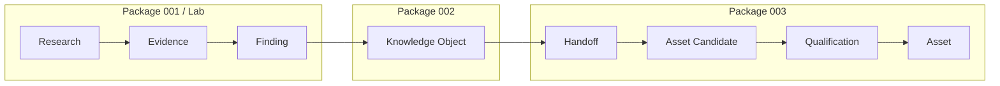
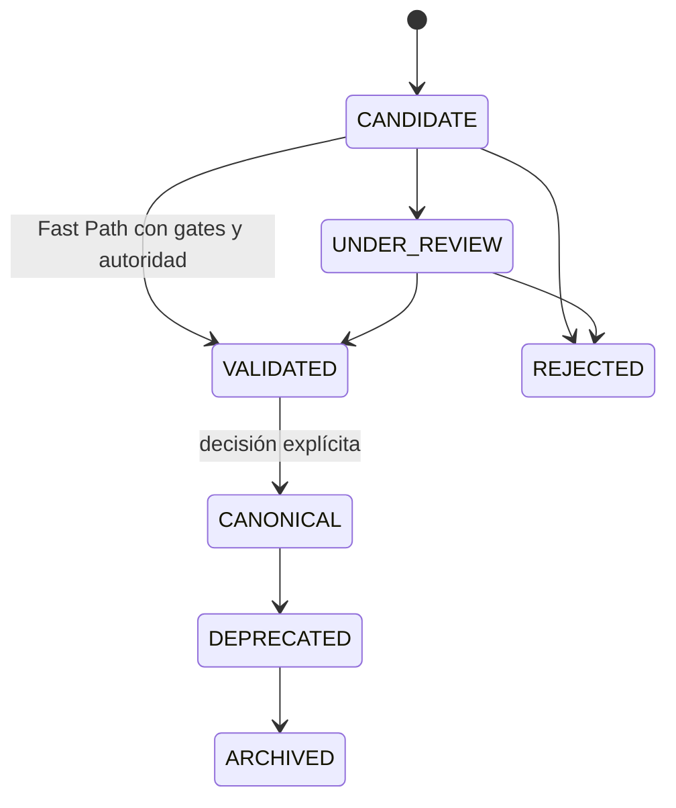
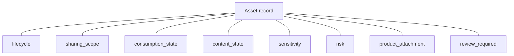
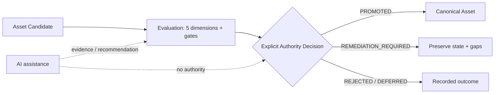
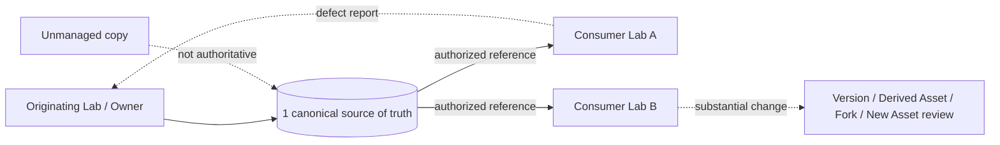
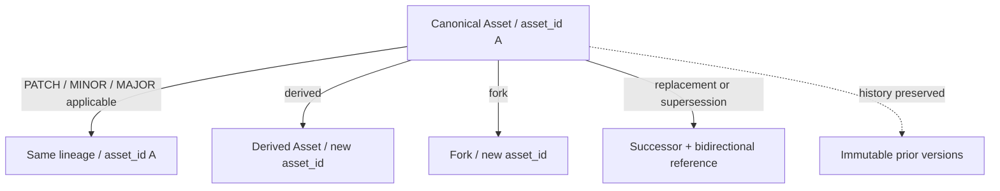
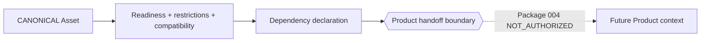
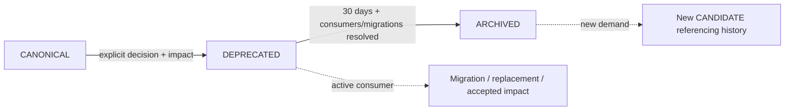

# Diagramas de Arquitectura del Asset System

## Alcance

[Decisión] Estos diagramas representan los modelos normativos de Package 003; no crean arquitectura, runtime ni autoridad nueva.

## 1. Knowledge → Asset

[Hecho] Package 002 conserva lifecycle, confidence, freshness y provenance del Knowledge Object. El handoff no renombra ni elimina el KO.

## 2. Lifecycle de Candidate

[Decisión] Son exactamente siete estados. ARCHIVED y REJECTED son terminales; reactivation crea un nuevo Candidate referenciado.

## 3. Dimensiones ortogonales

[Decisión] Ningún eje se deriva automáticamente de otro ni se convierte en lifecycle state.

## 4. Promotion

[Decisión] No existe `AUTO_PROMOTE`; AI no decide ni firma.

## 5. Source of truth y sharing entre Labs

[Decisión] Sharing no transfiere ownership ni Canonical_Authority. `sharing_scope` no demuestra consumo.

## 6. Versioning y evolución

[Decisión] MAJOR no oculta un cambio de identidad; derived Asset y fork reciben ID nuevo.

## 7. Asset → Product handoff

[Decisión] Package 003 se detiene en el boundary. No define Product lifecycle, Factory, pricing, customers ni Product architecture.

## 8. Deprecation y conservación

## Consistency audit

| Control | Resultado |
|---|---|
| Estados lifecycle | 7/7 |
| Automatic promotion/transitions | 0 |
| Orthogonal axes represented separately | 8/8 |
| Canonical sources per Asset | 1 |
| Reference-based sharing | PASS |
| Version history preserved | PASS |
| Product lifecycle represented | 0 |
| Capability activation represented | 0 |
| Runtime/implementation architecture | 0 |
