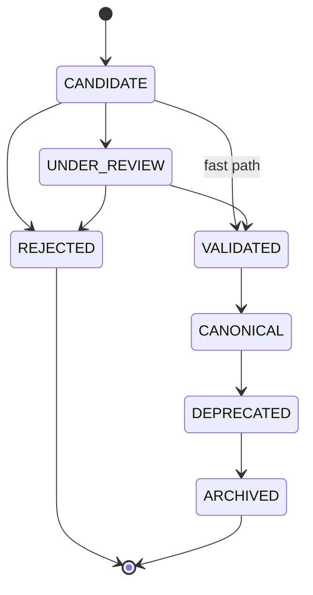

# Lifecycle de Gobernanza del Asset

## Autoridad

[Decisión] Este lifecycle implementa R3, R12 y R18 de Requirements v1.3 y Design v1.2.1 §3/§18. Es distinto del `content_state` de Package 000.

## Estados canónicos

| Estado | Significado | Entry criteria | Exit criteria | Autoridad | Review triggers |
|---|---|---|---|---|---|
| CANDIDATE | Artefacto registrado para posible reutilización | Cinco campos base, Tier 1 completo y señal documentada de reutilización potencial | Cinco dimensiones satisfechas; decisión de iniciar review, fast path o rechazo irremediable | Asset_Owner registra; Fundador decide transición | Gaps de intake, duplicación preliminar, source inaccesible |
| UNDER_REVIEW | Evaluación formal activa | CANDIDATE con cinco dimensiones SATISFECHAS y review iniciado | Gates de validación cumplidos o decisión irremediable | Fundador inicia; reviewer evalúa | Evidencia contradictoria, gate fallido |
| VALIDATED | Gates de validación cumplidos; falta decisión canónica | Cinco campos verificados, escenario concreto y sin duplicación VALIDATED/CANONICAL | Aprobación explícita a CANONICAL o permanencia documentada | Fundador | Review periódico si decisión diferida |
| CANONICAL | Asset aprobado y gobernado activamente | VALIDATED + aprobación explícita válida; o fast path completo | Condición de deprecación documentada | Fundador como Canonical_Authority | Forma B a 90 días, KO upstream, defectos, métricas, source inaccesible |
| DEPRECATED | Asset en retiro controlado | CANONICAL + condición y justificación de deprecación | ≥30 días y sin consumidores activos o migraciones confirmadas | Fundador | Consumidores pendientes, >180 días sin resolución |
| ARCHIVED | Registro histórico fuera de disponibilidad activa | DEPRECATED con condiciones de archivo cumplidas | Terminal; nueva demanda crea nuevo CANDIDATE | Fundador | Consulta histórica; evidencia nueva no cambia este registro |
| REJECTED | Evaluación terminada como irremediable | CANDIDATE/UNDER_REVIEW + gates fallidos + motivo de irremediabilidad | Terminal | Fundador | Ninguno; se preserva evidencia histórica |

Estados: exactamente 7. [Decisión]

## Transiciones permitidas

| Transición | Guarda verificable |
|---|---|
| CANDIDATE → UNDER_REVIEW | Las cinco dimensiones R4 están SATISFECHAS y el Fundador inicia review |
| CANDIDATE → REJECTED | Incumplimiento irremediable y motivo documentado |
| CANDIDATE → VALIDATED | Fast Path: exposición efectiva Nivel 1, cinco dimensiones R4, risk override evaluado y aprobación única del Fundador |
| UNDER_REVIEW → VALIDATED | Cinco campos base verificados, hipótesis con escenario concreto y ausencia de duplicación |
| UNDER_REVIEW → REJECTED | Gate no superado, irremediable, con motivo |
| VALIDATED → CANONICAL | Aprobación explícita: decisor, fecha, Asset y justificación |
| CANONICAL → DEPRECATED | Sucesor CANONICAL, 90 días sin uso, o mantenimiento >8h sin demanda activa / costo mayor al valor del último uso, según evidencia aplicable |
| DEPRECATED → ARCHIVED | ≥30 días; sin consumidores activos o todas las migraciones confirmadas; historia preservada |

## Transiciones inválidas

[Decisión] Toda transición no listada se rechaza indicando estado actual y salidas válidas. Son explícitamente inválidas las regresiones desde CANONICAL, DEPRECATED, ARCHIVED o REJECTED; VALIDATED no vuelve a CANDIDATE; REJECTED y ARCHIVED son terminales. Reactivación, fork o reemplazo crea un nuevo CANDIDATE con referencia al registro original.

## Dimensiones ortogonales

`content_state`, `sharing_scope`, `consumption_state`, `product_attachment`, `review_required`, `sensitivity`, `risk_level` y `value_status` no son estados ni producen una transición automática. [Decisión]

## Integridad diagrama–tabla

| Control | Resultado |
|---|---|
| Estados en tabla | 7 |
| Estados en diagrama | 7 |
| Transiciones autorizadas representadas | 8 + fast path en dos pasos |
| Dimensiones ortogonales usadas como estados | 0 |
| Regresiones permitidas | 0 |
