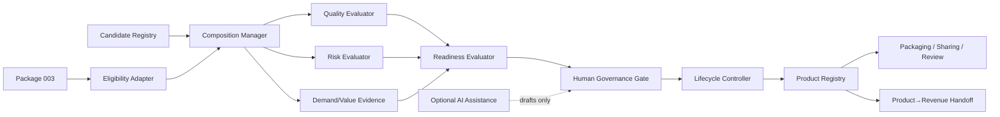
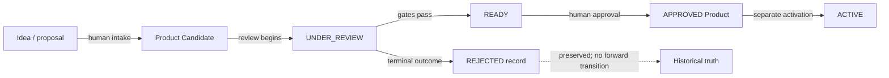

# Package 004 — Product Factory Design

## Document control

| Field | Value |
|---|---|
| Version | 1.0 |
| Date | 2026-09-03 |
| Status | `APPROVED` |
| Package state | `AUTHORIZED_FOR_DESIGN` |
| Requirements baseline | v1.0 `APPROVED` — `FD-P004-REQ-001` |
| Design authorization | `FD-P004-DESIGN-AUTH-001` |
| Founder Design approval | `FD-P004-DESIGN-001` |
| Scope | Implementation-neutral structural Design only |
| Tasks / implementation | `NOT_AUTHORIZED` |

This Design explains how approved concepts interact. It does not create new normative Product behavior. Any structural need outside Requirements v1.0 is routed as `REQUIREMENTS_CHANGE_REQUIRED`.

## DESIGN_SOURCE_MAP

| Code | Source / status | Authority and scope | Design contract consumed | Primary trace |
|---|---|---|---|---|
| ARCH | `LABOS-ARCH-BASELINE-001` v1.0; Freeze `FD-FREEZE-001`; change control; approved roadmap and post-P003 reconciliation | Frozen architecture; governing within baseline scope | Research→Knowledge→Assets→Products→Revenue, human authority, compatible extension, package ordering | R01, R08, R19, R21, R24–R25 |
| P000 | Package 000 Foundation README and company/business/portfolio records; closed baseline source | Foundation authority | Asset-first, problem/value discipline, SOLO governance and demand-before-investment | R01, R07, R13–R14, R16 |
| P001 | Package 001 lifecycle, evidence, quality, validation and Research→Asset/Product-hypothesis records; closed | Research/evidence authority | Evidence references, falsifiability, quality discipline and no evidence inflation | R09, R11–R15, R23 |
| P001A | Package 001A integration framework/contract and closure records; closed | Lab integration authority | Originating context, Lab boundary, Reference Lab and provenance | R01–R02, R09 |
| P002 | Package 002 lifecycle, ownership, SOT, provenance, versioning and Knowledge→Asset handoff; closed | Knowledge authority | One authoritative source, referenced lineage and preserved historical truth | R08–R10, R20, R23–R25 |
| P002A | Package 002A architectural center, invariants, decision matrix and approved roadmap | Architectural review authority | Package sequence, immutable closed packages and compatible extensions | R01, R19, R21, R25 |
| P003 | Package 003 v1.3 Requirements, effective Design v1.2.1, closure `FD-P003-CLOSURE-001`, lifecycle, ownership, SOT/provenance, versioning, sharing/restrictions, Registry and Asset→Product handoff | Final authority for Assets; read-only to P004 | Asset truth and the attachment-eligibility decision; P004 may only read/reference/consume | R04–R12, R17–R18, R22–R25 |
| P004-REQ | `requirements.md` v1.0 `APPROVED`; matrix, review, concept/boundary models, gap analysis and `FD-P004-REQ-001` | Normative Product Factory baseline; highest authority for this Design's Product behavior | All 25 Product Requirements and 100 acceptance criteria | R01–R25 |
| P004-AUTH | `FD-P004-DESIGN-AUTH-001`; effective 2026-09-03 | Authorizes Design only | Structural/implementation-neutral design; exclusions and stop conditions | R01–R25 |
| P004-README | Package 004 README; current-state index | Informational index subordinate to decisions and approved Requirements | Package identity, links and current phase | R01, R19, R25 |
| P005 | Package 005 boundary plus authoritative roadmap state | Revenue-stage authority remains dormant | Dossier handoff only; no price/payment/transaction/accounting/optimization | R13–R14, R21–R22 |

Precedence is: Founder decisions and frozen architecture within their scopes → approved Requirements v1.0 for Product behavior → closed upstream package authority for its own entities → supporting models/reviews → README/roadmap context. A downstream reference never copies or displaces upstream authority. Source conclusion: `NO_CONFLICT`; no `REQUIREMENTS_CHANGE_REQUIRED` or `ARCHITECTURE_CHANGE_REQUIRED` was found.

## Design principles

The design is technology-neutral, domain-neutral, manual-first, human-governed, traceable, auditable, provenance-preserving and historical-truth-preserving. Every conceptual component can be realized with governed documents and records. Automation may later reproduce the contract but cannot become its authority.

## Component model

| ID | Component | Responsibility / inputs → outputs | Authority and dependencies | Prohibited responsibility | Trace |
|---|---|---|---|---|---|
| C01 | Candidate Registry | Candidate intake → registered proposal and gaps | Human owner; Product SOT | Product approval or Asset mutation | R01–R03, R07–R09, R25 |
| C02 | Product Registry | Governed decisions/versions → current index plus immutable history | Product Authority; SOT references | Become Asset SOT or delete history | R01, R08–R10, R23–R25 |
| C03 | Composition Manager | Proposed references/dependencies → composition snapshot | Product Owner; C04/C11 | Copy Asset authority or attach implicitly | R04–R06, R17–R18 |
| C04 | Attachment Eligibility Adapter | Asset reference → consumed P003 eligibility decision | Package 003 only decides eligibility | Override or recompute P003 decision | R05–R06 |
| C05 | Lifecycle Controller | Requested transition/evidence → guarded transition record | Human Governance Gate | Automatic promotion | R03, R15–R16, R24–R25 |
| C06 | Readiness Evaluator | Eleven gate results → readiness decision packet | Human reviewer/authority | Opaque score or approval | R15 |
| C07 | Quality Evaluator | Product-quality evidence → dimension matrix | Product reviewer; Asset evidence by reference | Treat Asset quality as Product quality | R11 |
| C08 | Risk Evaluator | Product/upstream risks → residual-risk record | Human risk acceptance | Silently reduce restrictions | R06, R12, R22 |
| C09 | Value Evidence Manager | Consumer/problem/outcome evidence → value classification | Human reviewer | Infer revenue/readiness | R13 |
| C10 | Demand Validation Manager | Falsifiable plan/evidence → demand result | Human reviewer | Pricing, transaction or Revenue validation | R14 |
| C11 | Dependency Manager | Four dependency classes → dependency snapshot/impact | Product Owner; upstream providers | Hide platform dependencies | R18, R23–R24 |
| C12 | Provenance Manager | Candidate/Asset/evidence decisions → lineage graph | Source authorities referenced | Copy or fabricate authority | R09, R17, R21, R25 |
| C13 | Version Manager | Change/compatibility evidence → version/change record | Product Owner + human gate | Auto-change lifecycle or Asset version | R10, R23 |
| C14 | Packaging Model | Approved Product inputs → delivery manifest | Product Owner; C03/C11/C12 | Broaden rights or choose packaging technology | R17, R22 |
| C15 | Review/Freshness Controller | Event/date → review-required flag/record | Human reviewer | Automatic lifecycle change | R18, R23 |
| C16 | Sharing Controller | Requested audience/context/restrictions → sharing decision | Competent human authority | Equate ACTIVE with PUBLIC | R12, R22 |
| C17 | Retirement Controller | Deprecation evidence/impact → deprecation/retirement record | Product Authority | Delete history or bypass DEPRECATED | R23–R25 |
| C18 | Product→Revenue Handoff | Approved Product dossier → P005 handoff record | Human gate; P005 remains independent | Price/payment/transaction/accounting | R21–R22 |
| C19 | Human Governance Gate | Requested action/evidence/authority → authoritative decision | Founder/delegated human | Delegate final authority to AI | R03, R07, R12, R15–R16, R22–R24 |
| C20 | AI Assistance Boundary | Operation/subject → permission classification and draft | Human-reviewed, optional | Approve, transition, change authority/provenance | R19–R20 |

## Product aggregate

The aggregate root is a stable Product identity with one or more governed Product versions. Each version has exactly one Product SOT, one human Product Owner, one lifecycle state, one composition snapshot, and zero or more immutable governance/evidence references.

| Relationship | Cardinality | Character |
|---|---:|---|
| Product identity → Product version | `1 → 1..N` | Mandatory; prior versions preserved |
| Product identity → name and purpose | `1 → 1 each` | Mandatory Product distinction; absence is an explicit gap |
| Product version → Product Owner | `1 → 1` | Mandatory human |
| Product version → originating context | `1 → 1` | Mandatory reference; does not transfer Lab authority |
| Product version → target consumer/problem/value proposition | `1 → 1 each` | Mandatory identity relationship |
| Product version → governed composition input | `1 → 1..N` | Mandatory; Asset and/or declared external input |
| Composition → proposed/attached Asset reference | `1 → 0..N` | Optional by domain; effective attachment requires P003 eligibility |
| Product version → external/operational/platform dependency | `1 → 0..N` | Optional, explicit |
| Product version → evidence/governance record | `1 → 1..N` | Mandatory collection; exact types depend on state |
| Product version → quality/risk/value/readiness evaluation | `1 → 0..N each` | Optional during formation; the applicable current decision is mandatory at its governed gate |
| Product version → demand-validation record | `1 → 0..N` | Optional until demanded by the applicable readiness evidence |
| Product version → approval/activation record | `1 → 0..1 current each` | Absent before its gate; immutable historical records remain `0..N` |
| Product version → sharing decision | `1 → 0..N` | Separate from lifecycle; required for the requested sharing context |
| Product version → lifecycle state | `1 → 1` | Exactly one of the seven approved states at a time |
| Product version → provenance root | `1 → 1` | Mandatory route to Candidate and composition evidence; missing upstream lineage is an explicit gap |
| Product version → restriction | `1 → 0..N` | Optional but never omitted when applicable |
| Product version → SOT | `1 → 1` | Mandatory authoritative reference |
| Product version → review trigger | `1 → 1..N` | At least date or evidence-based event |

Supporting documentation is `0..N` during formation and becomes sufficient for applicable quality/readiness gates before READY; Design does not invent a universal count. Products need not be software or multi-Asset.

## Candidate-to-Product separation

A Candidate holds provisional identity, one human owner, problem, consumer, value hypothesis, proposed composition/dependencies, known restrictions, evidence references, evaluation state and optional terminal review outcome. It becomes a governed Product only through the approved lifecycle and explicit human decisions; identifiers and history remain linked, never collapsed.

| Candidate relationship | Cardinality / rule |
|---|---|
| Candidate identity, owner, problem, target consumer, value hypothesis and SOT | Exactly one of each for complete intake; missing elements produce named gaps and no complete registration |
| Proposed governed composition inputs | `1..N`; proposed Asset references may be `0..N` where another declared input is applicable |
| Proposed dependencies, restrictions and evidence references | `0..N`, but applicable known items may not be omitted |
| Evaluation state | Exactly one current evaluation view, distinct from lifecycle |
| Review outcome | `0..1` current outcome; `REJECTED` is terminal and historical, never Product approval |

## Design contracts

### Dependency, packaging, sharing and freshness structures

The Dependency Manager separates Asset, external, operational and platform dependencies. Each entry carries identity, purpose, criticality, current status, unavailability impact and fallback/exit expectation, plus version/compatibility constraint, owner/provider, restrictions and review requirement where applicable. An undeclared dependency is a named gap. A missing future LabOS platform never blocks the manual path merely because it would be convenient.

The Packaging Model produces a presentation manifest for one Product version: exact Product/version, eligible Asset references, supporting documentation, usage guidance, restrictions, dependencies, provenance reference, target consumer and delivery assumptions. The manifest references authoritative inputs and cannot broaden their rights. No archive, container or package-manager form is selected.

The Sharing Controller treats audience/distribution context as a separate governed request. It intersects Product restrictions, applicable Asset/external restrictions, licensing, sensitivity and intended consumer. ACTIVE supplies no implicit sharing permission; an exception requires competent human authority at every affected authority layer.

The Review/Freshness Controller records scheduled dates and material Asset/Product/dependency/schema, licensing/risk, evidence/use, demand/consumer/context or source-access triggers. It emits a review-required flag and common governance record, never an automatic transition.

Detailed lifecycle, composition, governance, Registry, manual workflow and Revenue handoff designs are maintained in the sibling documents referenced below. Together they form Design v0.1; none is an implementation schema.

- [Product lifecycle](./product-lifecycle-design.md)
- [Composition and P003 interface](./product-composition-design.md)
- [Governance/evidence](./product-governance-design.md)
- [Product Registry](./product-registry-design.md)
- [Product→Revenue handoff](./product-revenue-handoff-design.md)
- [Manual-first workflow](./manual-first-workflow-design.md)
- [Design decisions](./design-decision-register.md)
- [Design traceability](./design-requirements-traceability-matrix.md)
- [Gap analysis](./design-gap-analysis.md)
- [Independent review](./design-review.md)

## Package state and non-scope

Package 004 remains `AUTHORIZED_FOR_DESIGN`. Design v1.0 is `APPROVED` by `FD-P004-DESIGN-001`. Tasks, implementation, real Candidates/Products/attachments, Asset changes, commercialization and other Package activations are not authorized.

Next safe action: `PACKAGE_004_TASKS_AUTHORIZATION_DECISION`.
