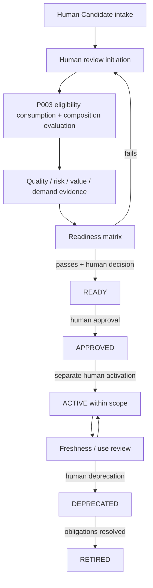

# Package 004 — Manual-First Workflow Design

## Documentary operating path

Every step can be performed with governed templates, referenced evidence and human signatures/decisions; no software, database, automation, Package 006/007, Persistence, RAG, MCP or Agent Runtime is required.

## Step contract

| Step | Manual input | Human output |
|---|---|---|
| Formation | Candidate template and source references | Intake record or named gaps |
| Review | Candidate, authority assignment | Review-initiation/outcome record |
| Composition | P003 decisions and dependency declarations | Proposed composition/fit record |
| Evaluation | Quality/risk/value/demand evidence | Dimension matrices and findings |
| Readiness | Complete gate packet | Readiness decision |
| Approval | READY packet | Approval or rejection record |
| Activation | Approved Product, delivery/operating scope | Activation record |
| Operation/review | Evidence, triggers, restrictions | Review/continue/remediation/deprecation decision |
| Retirement | Impact and exit evidence | Retirement record and preserved history |

Optional AI may prepare drafts or comparisons; a human verifies sources and finalizes every authority-controlled record.

Trace: R02–R03, R05, R07, R11–R16, R19–R20, R23–R25.
