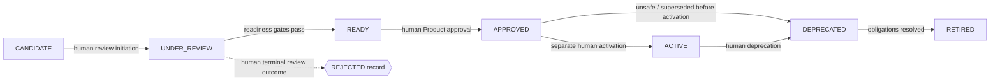

# Package 004 — Product Lifecycle Design

## State machine

The lifecycle contains exactly seven states. `REJECTED` is an outcome attached to the review record of a Candidate, not a state.

The seven rectangular nodes are the complete lifecycle state set. `REJECTED record` is deliberately rendered as a side-record shape and dotted outcome edge, not as a state. The Candidate retains lifecycle state `UNDER_REVIEW`, `review_outcome=REJECTED`, terminality, evidence, authority, timestamp and reason. It has no forward transition. A renewed proposal receives a new Candidate identity linked to the rejected record.

## Transition matrix

| ID | Source → destination/outcome | Trigger | Evidence and guard | Human authority | Resulting record | Automatic action prohibited |
|---|---|---|---|---|---|---|
| T01 | entry → CANDIDATE | Complete intake request | Required Candidate identity and one SOT; no Product claim | Human Candidate Owner | Intake record | Approval/attachment |
| T02 | CANDIDATE → UNDER_REVIEW | Review request | Owner, composition proposal, evidence/restriction inventory complete | Founder/delegated reviewer authority | Review-initiation record | Promotion by completeness alone |
| T03 | UNDER_REVIEW → READY | Readiness request | Applicable composition, evidence, quality, risk, provenance, ownership, dependencies, restrictions, consumer, demand and documentation gates pass | Founder/delegated Product Authority | Readiness decision | Product approval/activation |
| T04 | UNDER_REVIEW → REJECTED outcome | Reject request | Review evidence and explicit reason; terminality acknowledged | Founder/delegated Product Authority | Immutable rejection outcome | Delete, RETIRED conversion, forward transition |
| T05 | READY → APPROVED | Approval request | Valid readiness packet, restrictions and exact Product/version/scope | Founder/delegated Product Authority | Product approval record | ACTIVE/Public/commercial status |
| T06 | APPROVED → ACTIVE | Activation request | Delivery scope, operating controls, restrictions and effective date | Founder/delegated Product Authority | Activation/release record | Public/sale/revenue inference |
| T07 | APPROVED → DEPRECATED | Safety/supersession decision | Reason, dependency/consumer impact and exit plan | Product Authority | Deprecation record | Silent retirement |
| T08 | ACTIVE → DEPRECATED | Deprecation decision | Trigger evidence, impact, notices/migration plan | Product Authority | Deprecation record | New unrestricted consumers |
| T09 | DEPRECATED → RETIRED | Retirement request | Obligations resolved or explicit exceptions; history preserved | Product Authority | Retirement record | Deletion/reactivation |

Any other transition fails closed and records the failed guard. Review/freshness flags never change lifecycle automatically.

## ACTIVE semantics

ACTIVE means that an APPROVED Product version is available within an explicitly authorized operating/delivery scope. It does not mean PUBLIC, sold, revenue-generating, unrestricted or commercially authorized. Restrictions and review obligations continue.

## Review and retirement

Material Product/Asset/dependency/schema, licensing/risk, evidence/use, demand/consumer/context, source-access and freshness events create review-required flags. Deprecation records reason, effective date, replacement, impact and migration/exit expectations. Retirement follows DEPRECATED and preserves prior SOT, decisions and evidence.

Trace: R03, R15–R16, R23–R25.
