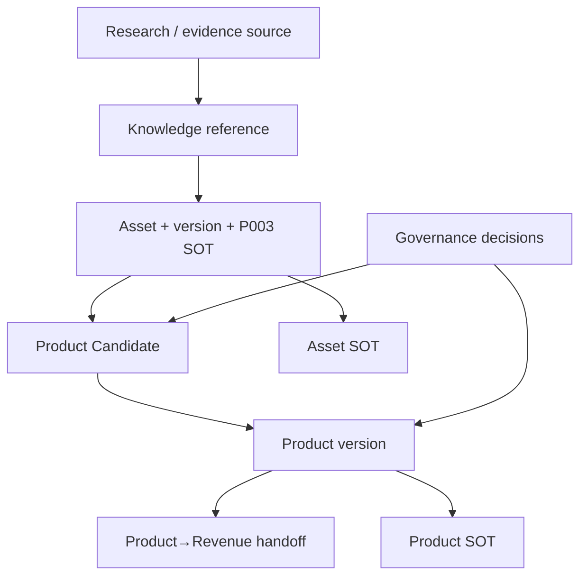

# Package 004 — Product Registry Design

## Conceptual structure

The Registry is a technology-neutral index over authoritative Candidate/Product records and immutable governance history. It is not itself required to be a database, API, service or application.

| View | Minimum answer |
|---|---|
| Candidate index | identity, owner, state, review outcome, proposed composition, SOT, restrictions, next review |
| Product index | Product/version, owner, lifecycle, composition, dependencies, restrictions, readiness, approval/activation, sharing, SOT, next review |
| Composition view | exact referenced input versions, eligibility decisions and contribution relationships |
| Evidence view | quality/risk/value/demand/readiness/provenance references and decision basis |
| History view | timestamp, prior/new value or state, actor/authority, reason, decision record |

Each governed Product version resolves exactly one authoritative Product SOT. Asset SOTs, evidence sources, working copies and derived representations remain separately labelled. Working/unmanaged copies have no authority. History is append-only conceptually; corrections add a superseding record rather than overwrite prior truth.

## Product version model

Product identity has `1..N` versions linked by `supersedes`. Requirements-defined `MAJOR.MINOR.PATCH` classification is recorded with rationale. Each version snapshots its Asset-version constraints and compatibility decision. Asset changes trigger review but never automatically change Product version or lifecycle. A fundamentally different offering receives a new Product identity.

## Provenance graph

The graph answers which evidence produced/supports the Product, which Assets/versions are used, which upstream lineage applies and which human decisions authorized each state. Missing historical links remain explicit gaps.

## Review/freshness

Every Registry subject exposes a next review date or event trigger. A fired trigger adds `review_required` without changing lifecycle. Duplicate IDs, unauthorized changes and silent history rewrites fail closed.

Trace: R01–R02, R08–R10, R18, R23–R25.
