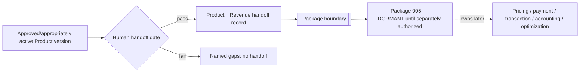

# Package 004 — Product→Revenue Handoff Design

## Boundary contract

The handoff is a governed, human-approved dossier made available to Package 005; it neither activates P005 nor records revenue.

## Dossier

The record references Product identity/version/state, human owner, Product SOT, target consumer, problem, value proposition/classification, demand evidence/status, governed composition and dependency snapshots, delivery/sharing assumptions, restrictions, quality/risk/readiness evidence, approval/activation records, provenance, and any monetization-hypothesis reference.

The gate fails for missing Product approval, incompatible licensing/sharing authority, unresolved blocking risk or incomplete mandatory dossier evidence.

## Explicit exclusion

P004 performs no price execution, payment, transaction, revenue accounting, revenue optimization or Revenue validation. `Product approved ≠ commercialization authorized`; `demand validated ≠ transaction`; handoff creation `≠ Package 005 activation`.

Trace: R13–R16, R18, R21–R22.
