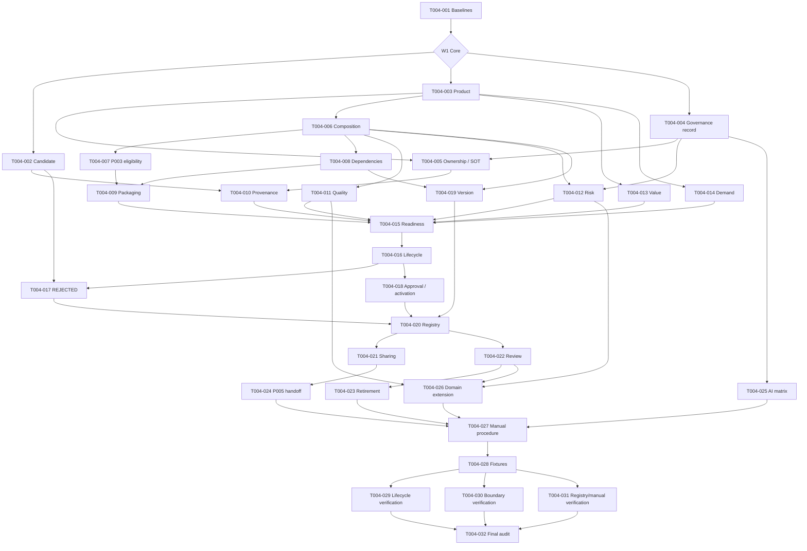

# Package 004 — Task Dependency Graph

## Dependency DAG

The diagram shows material sequencing; `tasks.md` is authoritative for complete prerequisite lists.

## DAG audit

| Control | Result |
|---|---|
| Tasks represented | `32/32` |
| Dependency cycles | `0` |
| Orphan Tasks | `0` |
| Tasks with undeclared upstream semantic dependency | `0` |
| Wave gate bypasses | `0` |

Critical blocking sequence:

`T004-001 → T004-003/004 → T004-006 → T004-008/009/010/011/012/013/014 → T004-015 → T004-016/018 → T004-020 → T004-021/022/023/024/025/026 → T004-027 → T004-028 → T004-029/030/031 → T004-032`.

Parallel branches exist inside W1–W6, but a Task is ready only when every dependency in its Task contract is COMPLETE and its wave is explicitly authorized. No wave is authorized here.

